<div align="center">

<pre>
███████╗███████╗███████╗██████╗ ███████╗ ██████╗███████╗███╗   ██╗███████╗
██╔════╝██╔════╝██╔════╝██╔══██╗██╔════╝██╔════╝██╔════╝████╗  ██║██╔════╝
███████╗█████╗  █████╗  ██║  ██║███████╗██║     █████╗  ██╔██╗ ██║█████╗
╚════██║██╔══╝  ██╔══╝  ██║  ██║╚════██║██║     ██╔══╝  ██║╚██╗██║██╔══╝
███████║███████╗███████╗██████╔╝███████║╚██████╗███████╗██║ ╚████║███████╗
╚══════╝╚══════╝╚══════╝╚═════╝ ╚══════╝ ╚═════╝╚══════╝╚═╝  ╚═══╝╚══════╝
</pre>

### One seed. One demo. Forever.

**Type a word. Get a demoscene production — music and motion — made just for it.
Then ride it through forty-five years of machines, from the arcade cabinet to now.**

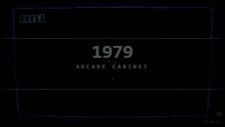

`v0.2` · 8 eras · 38 scenes · 24 music styles · 4 sound chips · endless autoplay · runs in your browser · renders to mp4 ·
no assets, only maths · built with [3dgiordano/agent-plugins](https://github.com/3dgiordano/agent-plugins)

</div>

---

## If you were there

You remember. A coin in the slot and `INSERT COIN` blinking in the dark. The blue screen and `READY.` The `LOAD"*",8,1` and the wait.
The border going mad with stripes while the tape squealed. *Insert disk 2.*
The `C:\>` prompt and a demo that somehow ran on a 486. A handheld with four
shades of green. And the intros — before the game, sometimes better than the
game: copper bars, a sine scroller, a plasma melting through a palette, a tune
you can still hum.

SEEDSCENE brings all of it back. Every machine gets its **era**: its own
resolution, its own palette, its own dither, its own screen — an arcade
monitor glowing in a dark room, a C64 on a TV,
an Amiga on a PAL monitor, VGA in mode 13h, a 32-bit console on composite, a
handheld LCD, the glossy 64k intros of the 2000s, today's shader art. And every
demo it plays has never been seen before — composed on the spot, from the word
you gave it.

## If you weren't

Think of a world seed in a game: the same word always builds the same world.
SEEDSCENE does that for **the demoscene** — the art form kids built on home
computers, squeezing impossible graphics and music out of machines with less
memory than a single photo on your phone.

Type your name, your birthday, your cat's name. You get your own music
video, in the style of any era you like. Send someone the word, and they get
the exact same one.

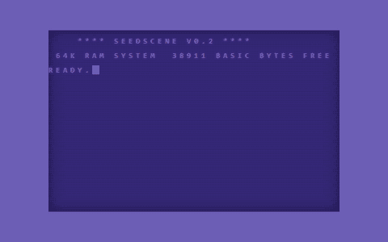

## Try it

```bash
npm install
npm run live
```

Or pick the word, the era, the music:

```bash
node bin/seedscene.js live    --seed yourname --era amiga
node bin/seedscene.js render  --seed yourname --style vectorballs --era dos --music gabber
node bin/seedscene.js journey  --seed yourname          # every era, 1979 to now → out/yourname-journey.mp4
node bin/seedscene.js autoplay --seed yourname --duration 3600   # an hour of it → out/yourname-autoplay.mp4
```

Press any key at `READY.` to run. Then press **`H`** any time to see every key
on screen (and `H` again to hide it):

| key | |
|---|---|
| `O` | **AUTOPLAY** — a new track every 40 seconds, scenes cut on the music, somewhere new each time |
| `T` | **THE JOURNEY** — every era in turn, 1979 to now |
| `E` · `1` … `8` | travel to the next era, or jump to one: arcade, C64, Amiga, DOS, console, handheld, Y2K, modern |
| `space` · `←` `→` | next / previous scene — in AUTOPLAY or THE JOURNEY, the next / previous track |
| `↑` `↓` | change the music style |
| `S` | a brand-new random seed |
| `M` | **the SETUP menu** — type your own seed; pick the scene, the era, the music, the resolution, the length, the sound; copy the command that reproduces it |
| `A` | **the About part** |
| `P` | pause |
| `V` | sound on / off — off, the demo plays on in silence, the picture still on the beat |
| `F` | fullscreen (do it) |
| `I` | the info panel |
| `H` | every key, on screen |

Everything you change is kept in the page address, so a reload brings back
the same demo — and **COPY LIVE COMMAND** / **COPY MP4 COMMAND** in the menu
give you the exact line to share it or render it to a video.

## Eight eras

An era is a screen, not a scene: any scene can be seen through any era. Leave
it on `auto` and the seed picks an era the scene belongs to, then music of
that era.

| | era | the screen | the music it brings |
|---|---|---|---|
| **1979** | `arcade` | the coin-op cabinet: a few hard, bright colours, heavy bloom, a curved tube | arcade attract, cyborg pulse, derelict ship, synth-pop |
| **1982** | `c64` | 16 colours, fat double-wide pixels, a TV in the bedroom | SID chiptune, synth-pop |
| **1990** | `amiga` | 4096-colour copper gradients with honest banding, PAL monitor | Amiga rave, New Beat, orchestral trackers, dreamwave, tracker jazz — on Paula's 8-bit samples |
| **1994** | `dos` | VGA mode 13h: 320×200, 256 colours, ordered dither | ambient techno, acid, gabber, eurodance, jungle, FM metal, MIDI quest — on a Sound Blaster 16's FM or an AWE32's wavetable |
| **1997** | `console` | 15-bit colour, the 32-bit consoles' dither, composite TV | heroic game soundtracks, eurodance, chip rock and roll, star pilot, MIDI quest — on wavetable |
| **1998** | `handheld` | four shades of green on a reflective LCD, pixel grid and all | handheld chip, chip rock and roll |
| **2002** | `y2k` | hi-res, glow on everything — the 64k intro | trance, happy hardcore |
| **2024** | `modern` | shader art: neon, film grain, chromatic aberration | synthwave, dreamwave |

## THE JOURNEY

Press **`T`** live, or run `seedscene journey`, and SEEDSCENE plays a trackmo
through all eight eras, oldest first. Each part is its own little production
— its own scene, its own music at its own tempo — and each opens with the line
its machine would have greeted you with: `INSERT COIN`, `LOAD "JOURNEY",8,1`,
`INSERT DISK 2`, `C:\SEEDSCENE> JOURNEY.EXE`, `PRESS START`, `POWER ON`,
`PRECALCULATING...`, `COMPILING SHADERS... DONE`. One seed, forty-five years.

## AUTOPLAY

Press **`O`** and lean back. SEEDSCENE becomes a channel that never ends: a new
track every forty seconds, three in one era, then on to another. Inside each
track the picture changes with the music: the scene cuts where the music turns
— on the drop after the break, on the crash that opens a phrase — so a track
plays two or three of its era's scenes, in a fresh order every block, never the
same pairing twice in a row. A new era opens with its card; every other track
with a **NOW PLAYING** lower third. `space` skips ahead, `←` goes back, `O`
returns you to your own demo.

The tracks mix into each other the way a DJ would mix them. The next track is
composed and ready as soon as the one before it starts. Its first bars then
play over the last bars of the outgoing one, beat on beat: across the overlap
both follow one tempo that glides from the old track's to the new one's. The
new track comes in thin, its lows filtered away; halfway the basslines swap;
then the old track fades behind a closing filter. THE JOURNEY's eras are
mixed the same way.

Live, AUTOPLAY drops in somewhere new in its channel every time you press
`O`, so it never plays the same sequence twice. The rendered channel is
still the seed's: `seedscene autoplay --duration 3600` puts an hour of it in
an mp4, the same every time for the same word.

## The arcade

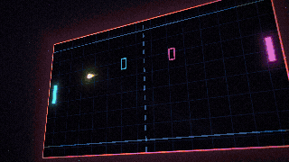

Before the demoscene there was the arcade, and SEEDSCENE starts there: eleven
game-inspired visualizers that move to the music instead of a joystick. Not a
replay of the games — a show made of them. Every game scene plays on a
**board floating in space** — and a game that is a device of its own, the LCD
juggler, floats as that device — and the camera rides the music round it: a
new angle on every eight-bar phrase, a punch in on the kick, a lean on the
snare, the board's neon frame breathing with the bass, and a zoom blur on
every kick.

Nine of them are real games underneath, run as small simulations locked to
the beat. The chomper hunts the nearest dot and dodges, while the wisps chase
it — one straight at it, one cutting it off, one keeping its distance — and
flee after a power dot. The snake steers for its food, keeps itself room to
escape, grows, and when it finally boxes itself in it bursts and starts again.
The rock ship flies round the field, dodges what is about to hit it, leads
its target and fires on the eighths: a big rock breaks in two, a small one
bursts, and now and then a rock gets through. The starfighter slides over and
turns its nose onto a drone — two sights ahead of it show where it points —
and fires from its wings along the nose once the sights are on; two hits and
the drone bursts. The drones come in from the far distance — over the planet,
from just above the horizon — and fire back on the backbeat; the ship slides
out of the way of the shots it sees, and one that lands shakes it and flashes
the screen once. The pyramid hopper turns the cube tops a hop a beat while the
red balls drop onto the second row and bounce down on the off-beats, and the
egg hatches into a snake that chases; a ball on its cube and it stops and
swears in a balloon, and with the snake close behind it rides a disc to the
top and the snake, following, falls.

Four of them play on the music's own grid, so their big moments land on it.
In **paddles** every return falls on a beat, and on an accent - the crash
that opens a phrase, the drop - the paddle the ball is heading for misses
and is blown apart on that very note; the other side scores. In **invaders**
the cannon times its shots so each alien bursts on a beat, and a saucer that
crosses the top is brought down on the accent. In **bricks** every flight of
the ball is timed to land on an eighth or a sixteenth, so the wall breaks on
the rhythm, and the paddle aims each return somewhere new. In
**lightcycles** four riders fly across the grid trailing walls of light,
turning on the beat and dodging between beats; a rider goes down only where
the music turns - two beats ahead, the game sends one of them into another's
wall, timing its speed so it blows up on the downbeat that opens a phrase, or
on an accent. Same seed, same game, move
for move.

They are homages, drawn from nothing but maths — no sprite, no maze, no
character and no tune is copied from any game. The creatures in the
formation, the mazes, the rocks and the challenger robot are all made up by
the seed.

## Thirty-eight scenes, straight out of the scene

| | | |
|---|---|---|
| 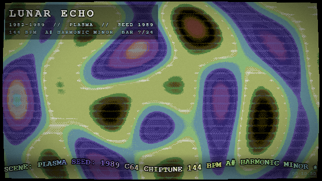 | 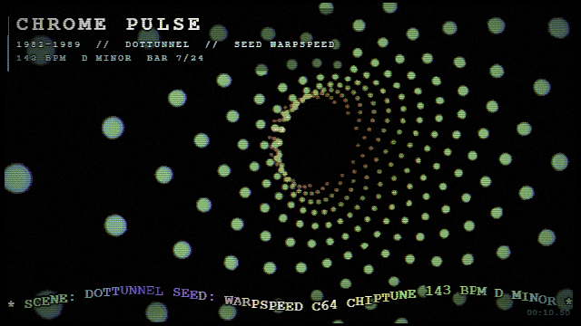 | 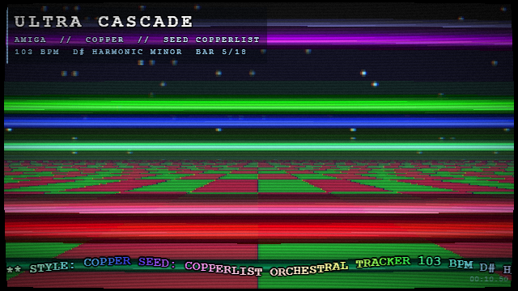 |
| **plasma** — sine waves melting through a palette. *Handheld,* `--seed 1989` | **dottunnel** — rings of dots rushing down a snaking tunnel. *C64,* `--seed warpspeed` | **copper** — copper bars glowing over an endless checkerboard. *Amiga,* `--seed copperlist` |
| 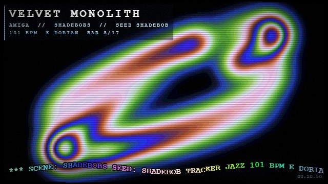 | 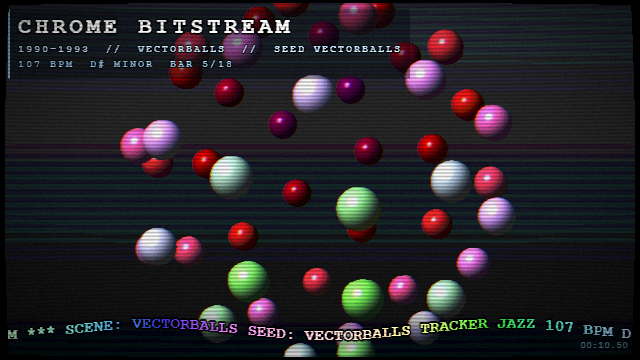 | 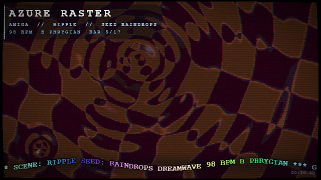 |
| **shadebobs** — glowing trails that wrap round the palette. *Amiga,* `--seed shadebob` | **vectorballs** — shaded spheres morphing between shapes every two bars. *Amiga,* `--seed vectorballs` | **ripple** — drops landing on the beat across a pool floor. *Amiga,* `--seed raindrops` |
| 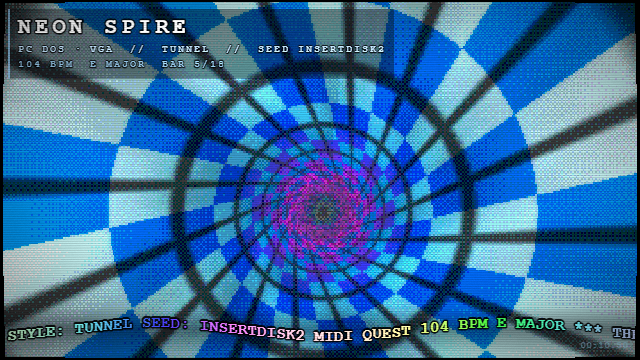 | 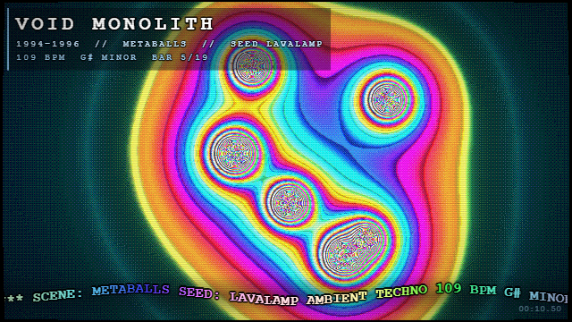 | 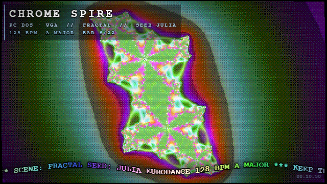 |
| **tunnel** — a twisting, texture-mapped tunnel punched by the kick. *DOS,* `--seed insertdisk2` | **metaballs** — liquid blobs that merge and split. *DOS,* `--seed lavalamp` | **fractal** — an orbiting Julia set, the classic end-part. *DOS,* `--seed julia` |
| 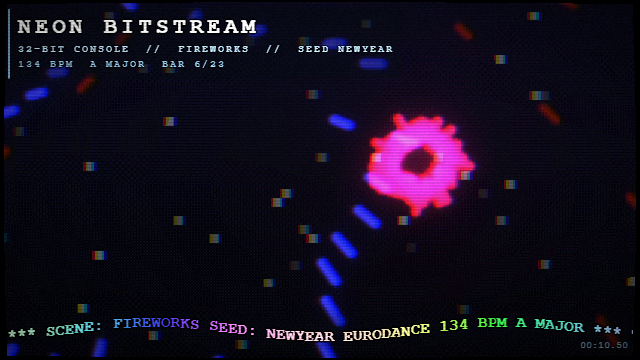 | 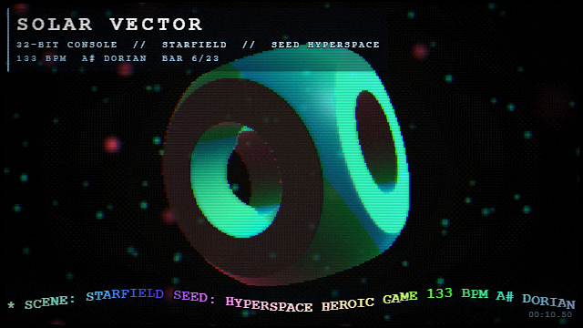 | 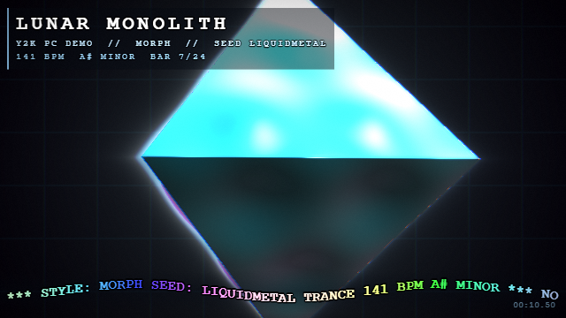 |
| **fireworks** — a burst on every backbeat, streaks falling to earth. *Console,* `--seed newyear` | **starfield** — warp speed around a drilled glenz-vector solid. *Console,* `--seed hyperspace` | **morph** — a raymarched solid melting between shapes on the bar. *Y2K,* `--seed liquidmetal` |
| 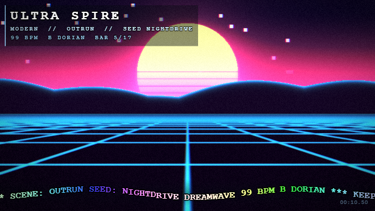 | 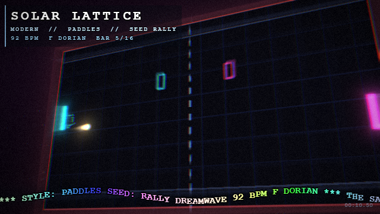 | 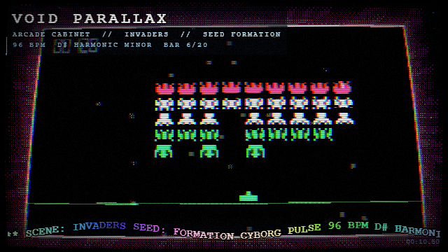 |
| **outrun** — the synthwave sunset: striped sun, neon grid, mountains. *Modern,* `--seed nightdrive` | **paddles** — the first video game in neon: a return on every beat, and on an accent a paddle misses and is blown apart. *Modern,* `--seed rally` | **invaders** — a formation the seed invents, a step per beat; each shot lands on a beat and the alien bursts on the kick. *Arcade,* `--seed formation` |
| 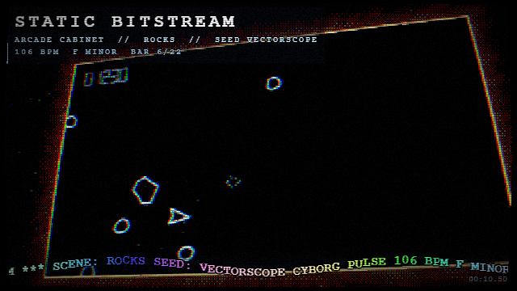 | 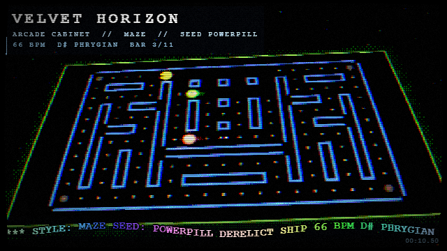 | 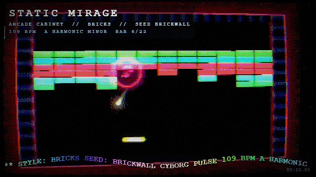 |
| **rocks** — a ship that flies, dodges and fires on the eighths; hit rocks break in two, in glowing phosphor lines. *Arcade,* `--seed vectorscope` | **maze** — a chomper hunting dots round a mirrored neon maze, three wisps on the chase, a new maze each time it is cleared. *Arcade,* `--seed powerpill` | **bricks** — a neon wall broken on the rhythm by a ball that goes somewhere new each return. *Arcade,* `--seed brickwall` |
| 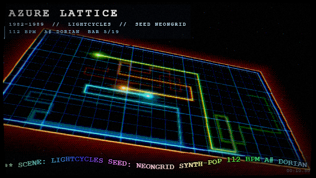 | 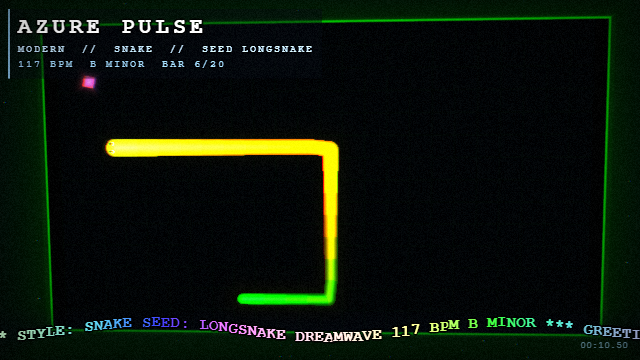 | 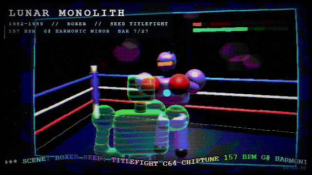 |
| **lightcycles** — four riders flying on a neon grid trailing walls of light, turning on the beat; on the downbeat that opens a phrase, one is sent into another's wall and blows up. *Modern,* `--seed neongrid` | **snake** — a neon snake that hunts its food, grows, and bursts when it boxes itself in. *Modern,* `--seed longsnake` | **boxer** — a title fight between two robots, staged like the console classics: hooks, jab flurries, uppercuts and showboating on the beat; yours, see-through, slips and punishes; on the crash a star punch switches him off, he crumples and the count goes up. *Arcade,* `--seed titlefight` |
| 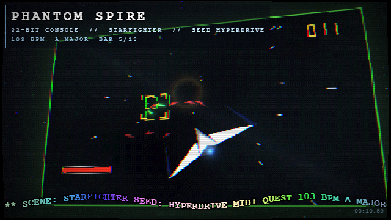 | 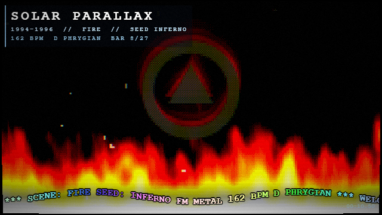 | 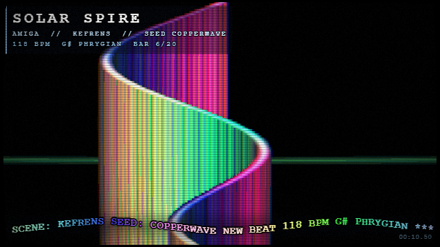 |
| **starfighter** — an on-rails run in flat-shaded polygons, after the 16-bit console classic: a white fighter with tall blue fins turns its nose and sights onto a red delta-wing, fires along them and bursts it; the drones come in from the horizon or the far distance, their shots come back, the ship slides out of their way, and one that lands shakes it and flashes the screen once. Space of points of light that stretch into a warp at each new sector; a planet of snowy mountains, clouds and stone arches, the ship's shadow running on the ground; a red shield bar. *Console,* `--seed hyperdrive` | **fire** — the classic 256-colour fire of the DOS demos: tongues of flame leaping on the kick, sparks flying up on the snare, and at the peak of the music a seed-made emblem catching fire. *DOS,* `--seed inferno` | **kefrens** — the Amiga classic: a shaded bar on every raster line, never cleared, piling up into a ribbon that weaves wider on the bass, fattens on the kick and turns colour with the bars of the music. *Amiga,* `--seed copperwave` |
| 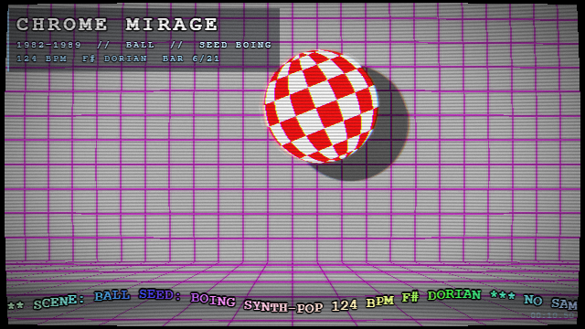 | 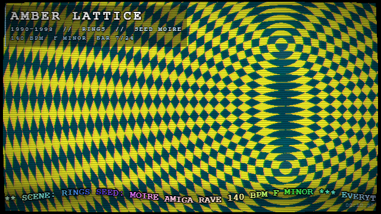 | 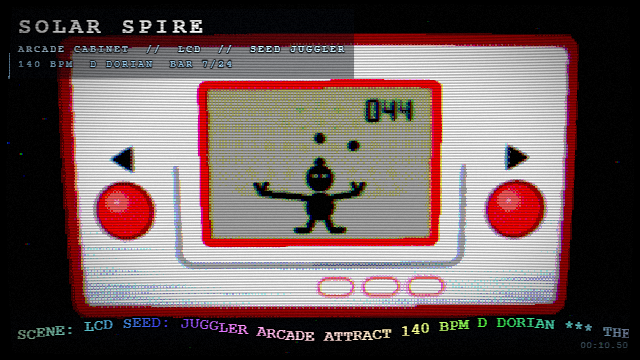 |
| **ball** — the Amiga's first and most famous demo: the red and white ball spinning on its tilted axis, bouncing from wall to wall of a grid room with its shadow behind it — landing on every beat, spinning faster as the music builds. *Amiga,* `--seed boing` | **rings** — interference rings: two sets of rings drifting through each other, every crossing flipping the colour into a moiré that seems to move on its own; they run outward on the kick, tighten on the bass, and a third set joins in at the peak. *Amiga,* `--seed moire` | **lcd** — the juggling LCD handheld of 1980, the whole device: brushed silver in a maroon case, two big round red buttons, the grey screen in its red border; on it a juggler in black segments, arms straight out, balls hopping cell by cell and landing in a hand on the beat, the side button going down for each catch, the score counting them. The whole device floats in space, punching in on the kick. *Arcade,* `--seed juggler` |
| 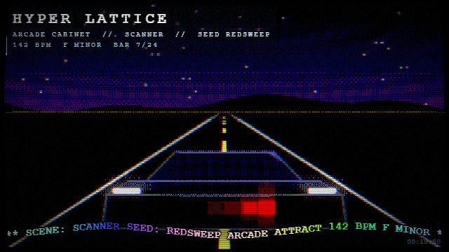 | 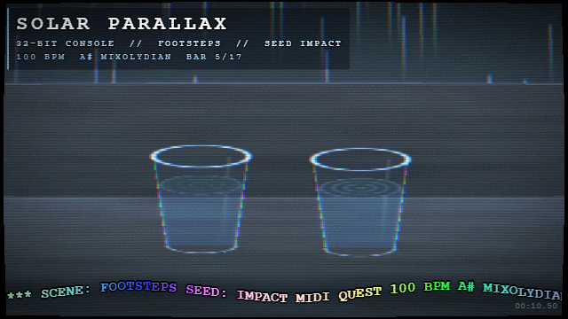 | 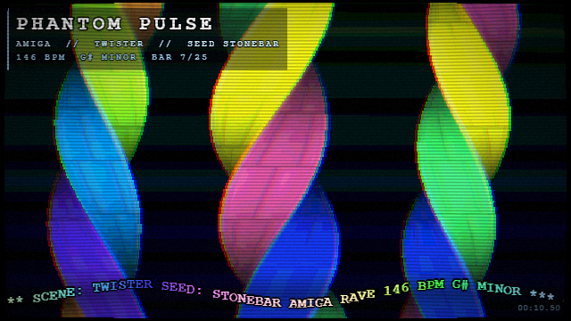 |
| **scanner** — the talking car of 80s television, as an idea: a long, low black car coming down a night road straight at you, the red light in its nose sweeping left and right, one pass on every beat, a trail fading behind it; the road rushes faster as the music builds. *Arcade,* `--seed redsweep` | **footsteps** — the dinosaur films' most famous warning, as an idea: two plastic cups of water on a car's dashboard, at night in the rain, the water trembling into rings with every footstep — the left cup on the kick, the right on the snare — until, at the peak, the light drops as something huge goes by. Nothing of the animal is shown. *Console,* `--seed impact` | **twister** — the twisted bar of the Amiga and Atari ST demos: a square column of block-textured faces, each lit by the angle it turns to you, twisting up the screen; the twist winds up as the music builds, the bar snaps a quarter turn on the kick, and at the peak two more join it. *Amiga,* `--seed stonebar` |
| 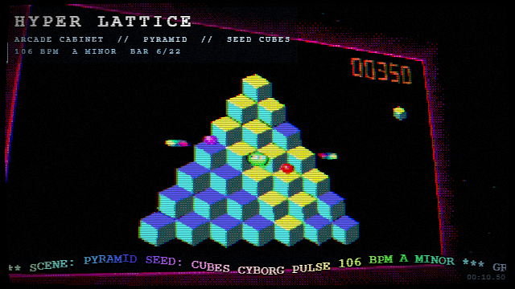 | 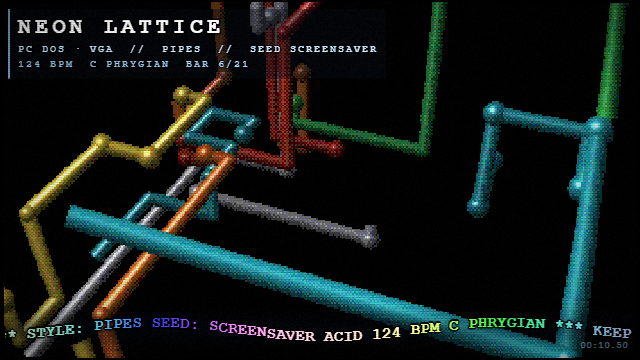 | 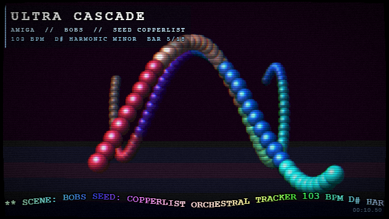 |
| **pyramid** — the cube-pyramid hopper of the 1982 arcades, played, on a board floating in space: a round green hopper of its own hops a cube a beat to turn every top, while the game's enemies come down between the beats — red balls dropping onto the second row and bouncing down at random, a purple egg that hatches into a coiled snake and chases. A ball or the snake on its cube and it stops and swears in a balloon; with the snake close behind it rides a disc to the top and the snake, following, falls. Each round the pyramid builds itself a row an eighth note, every landing ripples through the cubes, and a won round is a wave of jumping cubes before it falls away. *Arcade,* `--seed cubes` | **pipes** — the 3D pipes screensaver of the mid-90s office PC, seen from above: shiny pipes of solid colours growing cell by cell through a deep grid, never into a cell another holds, turning on the eighth notes with a smooth elbow (now and then a ball joint). The tangle fills from the distance forwards for sixteen bars until the screen is saturated, then dissolves in blocks through the last bar; the camera punches in on the kick. *DOS,* `--seed screensaver` | **bobs** — unlimited bobs, the Amiga and Atari ST trick: a few screens shown in turn and never cleared, one shaded ball drawn each frame, so a chain of balls seems to slide along behind its head, tracing its path. Ours runs on the music's clock: it surges ahead on the kick and on the pitched hits — stabs, lead, arpeggio — and glides between them; older balls recede into the distance and fade, so the chain flows away into the depth. On the kick it swells and settles back, on the snare it lightens, each bar draws its colour, and the screen punches in on the kick and shakes with the bass. A twin chain runs the figure the other way in the other colours, and the two weave a knot as they cross. *Amiga,* `--seed copperlist` |
| 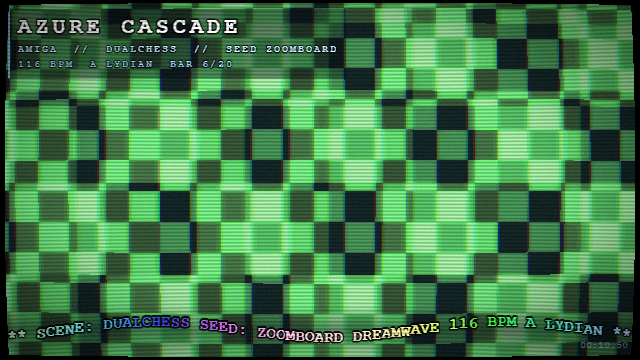 | 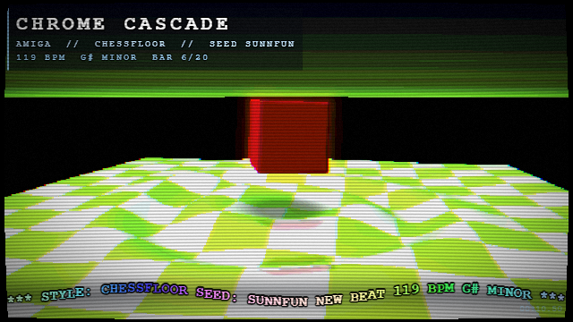 | 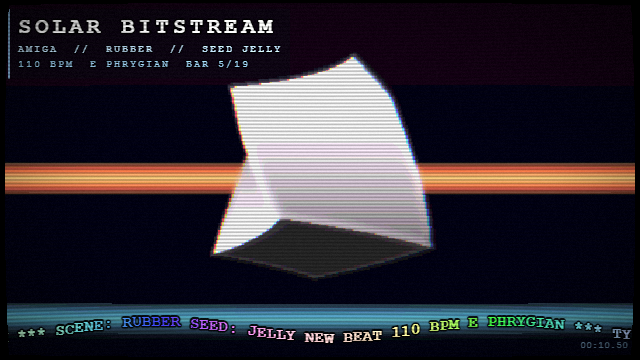 |
| **dualchess** — the dual chessboard of the Amiga intros: a chessboard on each bitplane, each zooming slowly between big squares and small ones, the palette giving every overlap its own shade. Two modes, a phrase each: the layers sliding sideways past each other at their own speeds; then the boards turning slowly on their own axes against each other, a quarter turn, breaking into moiré, square again for the next. The first board's squares punch in on the kick; the second breathes on the snare and slides with the bass; a third fades in for the second half of each phrase. *Amiga,* `--seed zoomboard` | **chessfloor** — the chessboard floor of the Amiga intros, with its cube: a board seen from above in perspective, turning beneath you, and a red cube bouncing on it. The board waves in 3D — a slow swell that grows with the bass, and every time the cube lands, on the beat, the board gives under it and a ring of waves runs out and dies away. The cube moves smoothly: its spin speeds up as the rhythm gets busy and slows as it thins, each hop set as it leaves. And the touches of the time: the cube mirrored in the board, glints on the wave crests, a glow round the cube, a bright copper line at the horizon. *Amiga,* `--seed sunnfun` | **rubber** — the rubber vector of the Amiga demos: a flat-shaded cube turning, its lower part lagging behind its top, so it bends and wobbles like jelly — each line of the screen shows the cube as it was a moment before, as the demos did with copies of the cube. Each kick gives the spin a shove that dies away, so the jolt runs down the cube like a wave through jelly; the snare tips it on a spring; the screen punches in on the kick and shakes with the bass, the copper bars behind flaring on the kick, a third joining them at the peak. *Amiga,* `--seed jelly` |
| 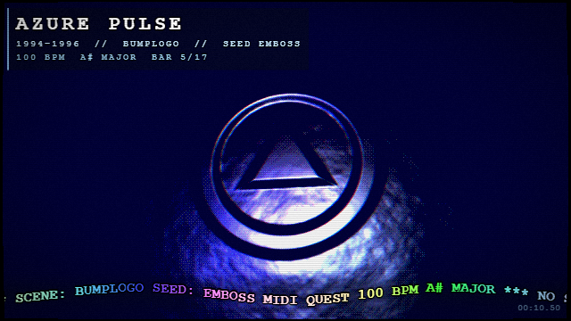 | 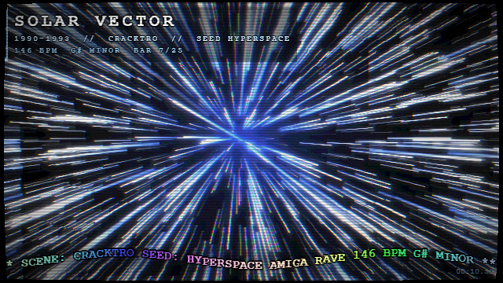 | |
| **bumplogo** — the bump-mapped logo of the mid-90s PC demos: an emblem raised out of rough stone, lit by moving coloured lights so it reads as embossed metal — done in 2D, as the demos did, each pixel's slope shifting where the light is looked up — on a plate seen at an angle, the camera leaning slowly round it. The lights circle the emblem and flare wider on the snare; the relief deepens on the kick, the screen punching in with it; a third light joins them in the second half of each phrase. *DOS,* `--seed emboss` | **cracktro** — the crack intro of the Amiga years and its starfield: a field of stars in depth that you fly through — drifting sideways, the near stars sliding past faster than the far ones, then diving forward or pulling back — steered by the music, a new heading every two bars, faster as it builds, a surge on each kick, and in the last two bars of each phrase a warp into the next — forward, the stars stretching into lines out of the middle as the jump to hyperspace did, or sideways into long streaks, each star glowing. It opens with the intro: a chrome SEEDSCENE logo bouncing on the beat over rainbow copper lines, and pages typing in, in a 5×7 bitmap font — what this is, and thanks to 3dgiordano and the SEEDSCENE community — which then fade away and leave the stars. *Amiga,* `--seed warez` | |

Every scene carries the two things no demo went without: a title plate and a
sine scroller that opens with **SEEDSCENE PRESENTS…** — and every scene is an
homage, written from scratch, to an effect the scene made famous.

## Twenty-four music styles, on the sound chips of their eras

Every seed composes its own track, like a tracker module that writes itself.
Let the era pick the style, or choose with `--music`, with `↑` `↓` while it
plays, or in the menu:

| style | | bpm |
|---|---|---|
| `chiptune` | Commodore 64 SID: pulse-width leads, square bass, 50 Hz arpeggio chords | 132–158 |
| `newbeat` | Belgian New Beat: slow, heavy EBM sequencer bass, big claps | 108–120 |
| `rave` | **Amiga rave, 1992**: chopped breakbeats, hoovers, sub bass, rave piano | 138–150 |
| `orchestral` | the orchestral tracker: strings, choir, timpani and brass in four channels | 96–120 |
| `dreamwave` | mellow cracktro synths and lush pads | 84–118 |
| `acid` | a squelching, sliding 303 over a 909, the filter knob always turning | 124–135 |
| `gabber` | Rotterdam, 1993: a distorted kick and nothing to hide behind | 175–190 |
| `ambient` | the chill-out room: deep pads, FM bells, a heartbeat kick | 92–110 |
| `eurodance` | hip-house organ bass, house piano, an anthem on top | 126–136 |
| `jungle` | amen breaks at 170 over a detuned reese bass | 164–174 |
| `heroic` | the game soundtrack: driving bass, brass, a lead that soars | 132–152 |
| `gameboy` | handheld chip: two pulses, a 4-bit wave, noise | 120–150 |
| `trance` | gated supersaws, rolling offbeat bass, snare rolls into big drops | 134–142 |
| `hardcore` | happy hardcore: 175 bpm, piano stabs, screaming leads | 168–180 |
| `synthwave` | the modern revival: gated snares, octave bass, neon arps | 92–118 |
| `arcade` | **arcade attract**: a pulse hook, a bass that marches down, zaps, blips and explosions in time and in key | 140–165 |
| `cyborg` | **cyborg pulse**: the mid-80s machine score — anvils in an odd 13-step metre, an ostinato bass, dark brass | 96–112 |
| `derelict` | **derelict ship**: deep-space dread — drones, a half-step that will not resolve, pings off the hull, a heartbeat | 64–76 |
| `synthpop` | **synth-pop**: the 80s chart single — gated drums, octave bass, the four chords everyone knows, a chorus you hum | 112–124 |
| `rocknroll` | **chip rock and roll**: a 50s shuffle on a sound chip — boogie bass, twelve bars, piano on the off-beat, a riff | 150–176 |
| `starpilot` | **star pilot**: 16-bit space opera — driving octave bass, a brass hook, orchestra hits, lasers in key, the minor sixth and seventh climbing home | 140–158 |
| `modjazz` | **tracker jazz**: the demo-party jazz tune — a walking slap bass, electric-piano comping on the off-beats, a flute that improvises, the ride swinging | 100–126 |
| `fmmetal` | **FM metal**: a DOS shooter at full tilt — palm-muted power chords, a double kick when it peaks, a guitar that solos | 150–178 |
| `midiquest` | **MIDI quest**: an adventure on a sound card — strings and choir, a harp running up and down, a flute, the timpani of a long road | 84–108 |

Each one is arranged like a real piece — intro, build, main part, a breakdown
with a riser, a crash into the drop, an outro. The newest five are built
around a **hook**: a two-bar call and answer the seed writes, landing on the
chord on the strong beats and coming home every fourth bar, so it sticks. Every sound is synthesized from
scratch in plain JavaScript: 909, gabber and break kicks, claps, a 303, a reese,
hoovers, supersaws, a rave piano, a house organ, strings, choir, timpani,
brass, FM bells, SID pulses, a 4-bit wave, struck anvils, laser zaps, coin
blips, explosions and deep-space drones. No recorded samples anywhere (on the
Amiga, Paula plays samples SEEDSCENE cuts from its own instruments) — and no melody
borrowed from anyone: the moods of the arcades, the sci-fi scores and the
charts are homages to sounds, not copies of songs. The chord loops are the
public-domain kind every pop song shares; every tune on top is the seed's.

**The sound chips.** A score says which notes to play; the era says what plays
them. The C64, the arcade, the handheld and the later eras use SEEDSCENE's
own synthesizer, as before. The others play the same score on the sound of
their machine:

| era | chip | how it sounds |
|---|---|---|
| `amiga` | **Paula** | every instrument sampled once, as a tracker musician would, cut to 8 bits at about 16.7 kHz (the drums at 28 kHz) and played back by stepping through the sample faster or slower with no smoothing — the grain and the aliasing of a MOD. Sustained sounds loop. Drums and lead hard left, bass and chords hard right, through the A500's output filter, almost dry. |
| `dos` | **Sound Blaster 16 (OPL3)** or **AWE32**, by the seed | OPL3: two-operator FM with the chip's seven waveforms and operator feedback, FM drums, and dry, like a DOS game. AWE32: wavetable instruments — a grand piano, string and brass sections, a choir, plucked bass and guitar, an acoustic kit — with the card's chorus and reverb. |
| `console` | **AWE32-style wavetable** | the sampled sound of the CD-era consoles |

Hear all twenty-four back to back, each on the chips of its eras:

```bash
npm run sampler        # → out/music-sampler.mp3
```

## The About part

Press **`A`** in live mode and SEEDSCENE plays its own demo about itself — the
part every production saved for the credits: a bouncing rainbow logo, a
greetings scroller racing along the top, pages slamming in on the beat, a
giant sine scroller with its reflection, raster bars over a spinning
checkerboard tunnel, and its own happy-hardcore soundtrack. `A` again drops
you back into your demo exactly where you left it.

## The promise: same seed, same demo

Not "similar". **Identical, byte for byte.** Every random choice is drawn from
a seeded generator; the synth counts in samples, not in clock time; the
renderer steps frame by frame and draws in software, so your graphics card
cannot change a pixel. THE JOURNEY and AUTOPLAY keep the same promise.

```bash
npm test     # renders the same seed twice and compares the files
```

That is what makes a seed worth sharing.

## For the tinkerers

Everything is web technology: WebGL2 fragment shaders for the scenes, a post
pass that draws each era's screen, an AudioWorklet for live sound, headless
Chrome and ffmpeg for the mp4. The visuals never listen to the audio — the
composer hands them each instrument's envelope directly — so the zoom lands on
exactly the frame the kick does, live or rendered.

```
seed ──> scene · era · music ──> composeScore ──┬──> Synth     ──> samples  ──> speakers / wav
                                                └──> Features  ──> uniforms ──> scene at the era's resolution
                                                                               ──> era screen ──> pixels
```

<details>
<summary><b>All command-line options</b></summary>

```
seedscene live    [options]     run it in a browser, in real time
seedscene render  [options]     render a demo to an mp4 file
seedscene journey [options]     render THE JOURNEY to an mp4 file
seedscene autoplay [options]    render AUTOPLAY to an mp4 file, as long as you like
seedscene styles                list the eras, scenes and music styles
seedscene info    [options]     show what a seed composes
```

| option | meaning | default |
|---|---|---|
| `--seed <word>` | anything at all; the same word always gives the same demo | random |
| `--style <name>` | one of the thirty-eight scenes | chosen by the seed |
| `--era <name>` | `auto` `arcade` `c64` `amiga` `dos` `console` `handheld` `y2k` `modern` | an era the scene belongs to |
| `--music <name>` | `auto` or one of the twenty-four styles | music of the era |
| `--res <WxH\|preset>` | `854x480`, or `240p` `360p` `480p` `576p` `720p` `1080p` | `480p` |
| `--duration <seconds>` | length | 30 render, 180 live, 128 journey, 600 autoplay |
| `--fps <n>` | frames per second | 30 |
| `--out <file.mp4>` | output path | `out/<seed>-<scene>.mp4` |
| `--crf <n>` | h.264 quality, lower is better | 18 |
| `--format <png\|jpeg>` | frame transfer format; jpeg is faster | png |
| `--gpu` | draw on the GPU: faster, but no longer identical across machines | off |
| `--no-overlay` | drop the title plate and the scroller | — |
| `--no-intro` | live mode: skip the LOAD sequence, straight to `READY.` | — |
| `--mute` | live mode: start with the sound off, to watch only (`V` turns it on) | — |
| `--port <n>` / `--no-open` | live server port; don't launch a browser | 8787 |

Run `npm link` once to type `seedscene` instead of `node bin/seedscene.js`.

</details>

<details>
<summary><b>Put it on the web</b></summary>

The live demo is a static site: nothing runs on the server. Build it and copy
the folder to any host that serves files — GitHub Pages, Netlify, an S3
bucket, nginx — at its root or in a subfolder:

```bash
npm run build:web
```

That writes `dist/` (about 500 KB, no build step, no dependencies). Its
`index.html` opens the live page: a visitor arriving with no seed of their own
gets the seed `seedscene`, straight into AUTOPLAY. A link with a seed opens
that seed's demo instead, and every setting of the live page works in the
address the same way (`?seed=aurora&style=cracktro`, `&autoplay=1` to start in
AUTOPLAY, `&sound=0` to start silent); the address keeps what the viewer
changes, so a reload or a shared link brings back the same demo.

On GitHub, publishing a release does all of it: a workflow checks the
same-seed promise, builds the site and deploys it to GitHub Pages — see
[docs/DEPLOY.md](docs/DEPLOY.md). The sound needs HTTPS: browsers allow the audio
worklet only on secure pages (or on `localhost`).

</details>

<details>
<summary><b>What's in the box</b></summary>

```
bin/seedscene.js      the command line
src/brand.js          the logo, the name and the About part texts
src/core/eras.js      the eight eras: resolution, palette, dither, screen
src/core/choose.js    what 'auto' means: scene, then era, then music
src/core/journey.js   THE JOURNEY and AUTOPLAY: tracks mixed beat on beat
src/core/sims.js      the games under the game scenes, and the scenes that move with the music
src/core/rng.js       seeded random streams
src/core/music.js     composer, twenty-four styles, synthesizer, feature track
src/core/chips.js     the sound chips: Paula, OPL3, AWE32
src/core/visual.js    renderer, palette, title plate, scroller, era cards
src/core/gl.js        WebGL2 helpers
src/styles/index.js   the thirty-eight scenes, the 3D stage, the About part, the era screen
src/app.js            ties the music and the picture together
web/index.html        the live page
web/boot.js           the C64 boot screen
web/menu.js           the SETUP menu
web/live.js           real-time loop, locked to the synth clock
web/worklet.js        AudioWorklet host for the synth
web/render.html       the page headless Chrome draws into
tools/render.js       audio + frames + ffmpeg → mp4
tools/gallery.js      regenerates the images on this page (npm run gallery)
tools/sampler.js      every music style in one mp3 (npm run sampler)
tools/server.js       local static server
tools/build-web.js    the live demo as a static site (npm run build:web)
.github/workflows/    publishing the site to GitHub Pages on each release
test/determinism.mjs  the same-seed promise, checked
SEEDSCENE.NFO         the release notes, the way they used to be written
```

Node 18+. `npm install` brings its own Chromium and its own ffmpeg; nothing
else to install.

</details>

## Built with agent-plugins

SEEDSCENE was written end to end by Claude, in Claude Code, with the ten
self-monitoring plugins from
**[3dgiordano/agent-plugins](https://github.com/3dgiordano/agent-plugins)**
running the whole time — with the
[v0.20.0](https://github.com/3dgiordano/agent-plugins/releases/tag/v0.20.0)
release installed for the finish of v0.2. They are what made the agent *watch* its own demos instead of
trusting its code: that is how broken effects were caught in rendered frames,
from metaballs that never merged to a dot tunnel that vanished in four shades
of green, and how a live-mode glitch was traced to two synths fighting over
one clock.

The exact plugin set for each version, with commits and what each plugin
caught, is on record in [docs/AGENT-PLUGINS.md](docs/AGENT-PLUGINS.md).
How each version was built, with token counts and cost, is in the build
reports: [v0.2](docs/BUILD-REPORT-v0.2.md) · [v0.1](docs/BUILD-REPORT-v0.1.md).

```bash
claude plugin marketplace add 3dgiordano/agent-plugins
```

## Greetings

To everyone who ever dropped a coin and pressed start. To everyone who ever typed `LOAD` and waited. To everyone who ever inserted
disk 2. To the trackers and the people who made them sing. To every coder
still up at 3 a.m. chasing one more frame — on a C64, an Amiga, a 486, a
handheld, or a GPU. To the kids about to type their name and see their first
demo.

**Keep the scene alive.**

---

<sub>v0.2 · [MIT license](LICENSE) · [changelog](CHANGELOG.md) · [release .NFO](SEEDSCENE.NFO) · build reports [v0.2](docs/BUILD-REPORT-v0.2.md) · [v0.1](docs/BUILD-REPORT-v0.1.md) · [agent plugins](docs/AGENT-PLUGINS.md)</sub>
