<div align="center">

<pre>
███████╗███████╗███████╗██████╗ ███████╗ ██████╗███████╗███╗   ██╗███████╗
██╔════╝██╔════╝██╔════╝██╔══██╗██╔════╝██╔════╝██╔════╝████╗  ██║██╔════╝
███████╗█████╗  █████╗  ██║  ██║███████╗██║     █████╗  ██╔██╗ ██║█████╗  
╚════██║██╔══╝  ██╔══╝  ██║  ██║╚════██║██║     ██╔══╝  ██║╚██╗██║██╔══╝  
███████║███████╗███████╗██████╔╝███████║╚██████╗███████╗██║ ╚████║███████╗
╚══════╝╚══════╝╚══════╝╚═════╝ ╚══════╝ ╚═════╝╚══════╝╚═╝  ╚═══╝╚══════╝
</pre>

### One seed. One demo. Forever.

**Type a word. Get a demoscene production — music and motion — made just for it.
Then ride it through half a century, from 1972 to now.**

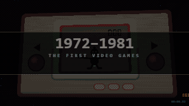

`v0.2` · 7 eras · 51 scenes · 35 music styles · 16 displays · 6 sound boards · endless autoplay · runs in your browser · renders to mp4 ·
no assets, only maths · built with [3dgiordano/agent-plugins](https://github.com/3dgiordano/agent-plugins)

</div>

---

## If you were there

You remember. A coin in the slot and `INSERT COIN` blinking in the dark. The blue screen and `READY.` The `LOAD"*",8,1` and the wait.
The border going mad with stripes while the tape squealed. *Insert disk 2.*
The `C:\>` prompt and a demo that somehow ran on a 486. A handheld with four
shades of green. And the intros — before the game, sometimes better than the
game: copper bars, a sine scroller, a plasma melting through a palette, a tune
you can still hum.

SEEDSCENE brings all of it back. Every stretch of years gets its **era** - its
scenes and its music - and every scene the **screen** it was seen on: its
palette, its dither, its glass - an arcade monitor glowing in a dark room, a C64
on a TV, an Amiga on a PAL monitor, VGA in mode 13h, a phone's green LCD, a film
on videotape, the glossy 64k intros of the 2000s. And every
demo it plays has never been seen before — composed on the spot, from the word
you gave it.

## If you weren't

Think of a world seed in a game: the same word always builds the same world.
SEEDSCENE does that for **the demoscene** — the art form kids built on home
computers, squeezing impossible graphics and music out of machines with less
memory than a single photo on your phone.

Type your name, your birthday, your cat's name. You get your own music
video, in the style of any era you like. Send someone the word, and they get
the exact same one.

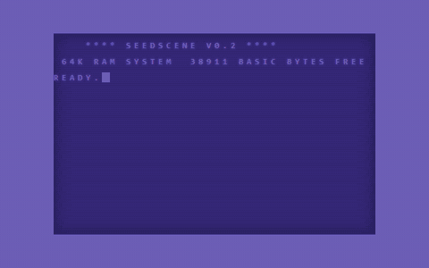

## Watch it online

Nothing to install: open a link and press any key at `READY.` (the browser
lets the sound start only after a key or a click). Then `H` shows every key.

| | |
|---|---|
| **[AUTOPLAY](https://3dgiordano.github.io/seedscene/)** | the endless channel: a new track every forty seconds, era after era |
| **[THE JOURNEY](https://3dgiordano.github.io/seedscene/?seed=seedscene&journey=1)** | every era with scenes of its own in turn, 1972 to the 2000s |
| **[Born in 1985](https://3dgiordano.github.io/seedscene/?seed=seedscene&autoplay=1&born=1985)** | AUTOPLAY from the era you were twelve in - change the year in the address, or press `B` |
| **[Greetings](https://3dgiordano.github.io/seedscene/?seed=hyperspace&scene=cracktro&era=amiga#greets=ANA,LUIS,THE+3+A.M.+CODERS)** | the cracktro greeting your friends - press `G` for your own names |
| **One era** | [1972–1981](https://3dgiordano.github.io/seedscene/?seed=insertcoin&era=1972) · [1982–1989](https://3dgiordano.github.io/seedscene/?seed=readyrun&era=1982) · [1990–1993](https://3dgiordano.github.io/seedscene/?seed=disk2&era=1990) · [1994–1996](https://3dgiordano.github.io/seedscene/?seed=soundblaster&era=1994) · [1997–1999](https://3dgiordano.github.io/seedscene/?seed=pressstart&era=1997) · [2000–2009](https://3dgiordano.github.io/seedscene/?seed=precalc&era=2000) |
| **Your own word** | `https://3dgiordano.github.io/seedscene/?seed=yourname` - the same word gives everyone the same demo |
| **A screensaver** | `https://3dgiordano.github.io/seedscene/?saver=10` - ten seconds untouched and AUTOPLAY takes the screen |

## Try it

```bash
npm install
npm run live
```

Or pick the word, the era, the music:

```bash
node bin/seedscene.js live    --seed yourname --era amiga
node bin/seedscene.js render  --seed yourname --scene vectorballs --era 1990 --music gabber
node bin/seedscene.js journey  --seed yourname          # every era, 1972 to the 2000s → out/yourname-journey.mp4
node bin/seedscene.js autoplay --seed yourname --duration 3600   # an hour of it → out/yourname-autoplay.mp4
```

Press any key at `READY.` to run. Then press **`H`** any time to see every key
on screen (and `H` again to hide it):

| key | |
|---|---|
| `O` | **AUTOPLAY** — a new track every 40 seconds, scenes cut on the music, somewhere new each time |
| `T` | **THE JOURNEY** — every era with scenes of its own in turn, 1972 to the 2000s |
| `B` | **BORN IN** — type the year you were born: AUTOPLAY opens in the era you were twelve in, and stays near it |
| `G` | **GREETINGS** — type a few names: they scroll in the greetings, and stay on this screen |
| `E` · `1` … `7` | travel to the next era (`E` passes through AUTO too), or jump to one: 1972–1981, 1982–1989, 1990–1993, 1994–1996, 1997–1999, 2000–2009, 2010–now - and to its first scene in your seed's order (2010–now, with none yet, keeps the scene) |
| `D` | display: AUTO (each scene its own screen), or force one screen on everything - B/W, MONO, C64, VHS, EGA, SNES, GAME BOY… |
| `C` | sound board: AUTO (each scene its own), or force one on all the music - HI-FI, PAULA, OPL3 FM, AWE32, YM2149, SID |
| `space` · `←` `→` | next / previous scene — era by era, oldest first, each era's scenes in the order your seed deals them; in AUTOPLAY or THE JOURNEY, the next / previous track |
| `↑` `↓` | change the music style — the era's own first, in your seed's order, then the other eras' |
| `S` | a brand-new random seed |
| `M` | **the SETUP menu** — type your own seed; pick the scene, the era, the music, the display, the sound board, the resolution, the length, the titles, sound on or off; copy the command that reproduces it |
| `A` | **the About part** |
| `P` | pause |
| `V` | sound on / off — off, the demo plays on in silence, the picture still on the beat |
| `F` | fullscreen (do it) |
| `I` | the info panel |
| `H` | every key, on screen |
| `Esc` | close what is open - the keys, the menu, About - or leave AUTOPLAY or THE JOURNEY |

Everything you change is kept in the page address, so a reload brings back
the same demo — and **COPY LIVE COMMAND** / **COPY MP4 COMMAND** in the menu
give you the exact line to share it or render it to a video (greetings stay out
of it: they are kept only in your address).

## Seven eras

An era is a span of years, not a machine: the scenes and the music that came
out then, and the display most of its things were seen on (see **Displays**
below). A scene belongs to the era of its year - a game or a film to the year
it came out, a demo effect to the years the scene made it famous (a few to two
or three, each seen through that era's display); a game or a film keeps its
own screen whatever the era. Leave it on `auto` and the seed picks an era the
scene belongs to, then music of that era; choose only the era, and the seed
picks one of that era's own scenes. Live, choosing an era (`E`, `1`–`7`, the
menu) goes to that era's first scene in the seed's order. On the command line
or in the address, a scene you name yourself is shown in whatever era you name
with it - its music and its display then the era's. An era is chosen by
the year it starts (`--era 1990`), any year inside it (`--era 1995`), or the
machine name it once had (`--era amiga`).

| years | | its display (scenes may have their own) | its scenes | the music it brings |
|---|---|---|---|---|
| **1972–1981** | the first video games | ARCADE | paddles, invaders, rocks, maze, lcd | arcade attract, cyborg pulse, derelict ship, synth-pop |
| **1982–1989** | home computers, arcades and the video shop | C64 | lightcycles, pyramid, boxer, bricks, outrun, scanner, timecar, moonbike, dottunnel, plasma, ball | SID chiptune, synth-pop, ST buzz, italo disco — on the C64's SID, the Atari ST's YM2149 or the synthesizer's own voices, by the seed |
| **1990–1993** | the demoscene's golden years | AMIGA | the Amiga effects - copper, kefrens, vector balls, the chessboards, the cracktro and more - plasma, metaballs, tunnel, fractal, bumplogo, fireworks, morph; footsteps, starfighter, cascade, echolines | Amiga rave, New Beat, orchestral trackers, dreamwave, tracker jazz, beast lands, lament, musicdisk ballad, jolly march, hip-hop blaster — on Paula's 8-bit samples |
| **1994–1996** | the PC demos and the multimedia years | VGA | fire, pipes, ansi, maze3d; fractal, tunnel, metaballs, plasma, bumplogo | ambient techno, acid, gabber, eurodance, jungle, FM metal, MIDI quest — on a Sound Blaster 16's FM or an AWE32's wavetable; and keygen, the party's tracker tunes, played from samples as a module player did; and trip-hop, its strings and Rhodes on the card; and lament and jolly march, played on the card |
| **1997–1999** | 3D consoles and pocket screens | COMPOSITE TV | snake, animeop, coderain | heroic game soundtracks, eurodance, chip rock and roll, star pilot, MIDI quest, the anime opening, skate punk, handheld chip, jolly march — on wavetable |
| **2000–2009** | the 64k intro | SVGA | morph, gimbal, djdecks | trance, happy hardcore, keygen, trip-hop |
| **2010–now** | shader art | MODERN | prism, sculpture, fractalflight | synthwave, dreamwave |

## Displays

How a picture looked depends on the screen it was made for, so SEEDSCENE keeps
its screens apart from its eras: a **display** is a screen and its signal - a
palette, a dither, a tube, a glass or a tape. It is a simulation for today's
eyes: the picture is always drawn at full resolution, never lowered to its
machine's, and a display adds only what its screen did - scan lines, curvature,
glow and fringes for what was seen on a CRT; for an LCD or anything later, only
its palette. Each display is one technology, named for it. On **AUTO** (the
default) every scene is seen through the screen it belongs to: a game through
its own machine's (the first paddle game on a black-and-white set, the arcade games on the
arcade monitor, the rocks on a vector monitor, the phone's snake on the phone, the 16-bit space shooter on its
console), a film or a television series
through the videotape it was watched on, the LCD game as it draws its own
device (MODERN). The demo effects go through their era's, with three
exceptions: the bouncing ball on the AMIGA it was made on, and the card cascade
and the bouncing lines on the PC's VGA.
Press **`D`** (or use the menu, `?display=` in the address, `--display` on the
command line) to force one display on everything - today's scenes on
yesterday's screens.

| display | the screen |
|---|---|
| `bw` **B/W** | a black-and-white television: grey, soft and grainy |
| `arcade` **ARCADE** | the coin-op raster monitor: a few hard, bright colours, heavy bloom, a curved tube |
| `vector` **VECTOR** | the black-and-white vector monitor: a beam drawing only lines - the outlines of whatever a picture fills - on unlit phosphor, blue-white, sixteen intensities, a glow round every line |
| `colorvector` **COLOR VECTOR** | the colour vector monitor: lines and outlines only, in seven colours - three guns each on or off - at any intensity |
| `mono` **MONO** | green phosphor on black, the office PC before colour |
| `c64` **C64** | the 8-bit home computer's 16 colours, on the family TV |
| `vhs` **VHS** | a film or a series on tape, played back well: soft brightness the deck sharpens back, colour smeared wide and a little late, lines that wave, the heads switching at the bottom |
| `ega` **EGA** | the sixteen fixed colours of the early PC, dithered |
| `amiga` **AMIGA** | 4096-colour copper gradients with honest banding, a PAL monitor |
| `vga` **VGA** | the PC's 256-colour mode, dithered, on its monitor |
| `snes` **SNES** | the 16-bit console: 15-bit colour without dither, on the TV |
| `composite` **COMPOSITE TV** | the late-90s consoles on a composite TV: 15-bit colour, ordered dither |
| `gameboy` **GAME BOY** | the handheld's reflective STN (passive-matrix) LCD: four shades of green, pixel grid and all |
| `nokia` **NOKIA** | the phone's monochrome LCD: dark pixels on a green backlight |
| `svga` **SVGA** | hi-res and glow on everything, the 64k intro |
| `modern` **MODERN** | no filter: the picture as it is drawn |

## Sound boards

As a display is the screen a thing was seen on, a **sound board** is what its
music came out of. On **AUTO** (the default) each scene plays on its own: a
film or a series always on the studio's full quality, and so a game whose machine has
no board here (the 16-bit space shooter, the phone's snake, the LCD game); the
Amiga's ball on its sample chip, the PC desktop's card game and screensaver on
the sound card; every other scene on its era's (the C64's SID on half the tracks, the Atari ST's
chip or the synthesizer's own voices on the rest in 1982–1989, by the seed; the Amiga's samples in
1990–1993, the PC's FM or wavetable card in 1994–1996, wavetable in 1997–1999 -
though both of that era's scenes have boards of their own, so on AUTO it is heard
there only when forced - the synthesizer's own voices elsewhere). The style of music stays the seed's and the era's: the
board is only what plays it. Press **`C`** (or use the menu, `?board=` in the
address, `--board` on the command line) to force one board on all the music.
In AUTOPLAY and THE JOURNEY a track plays on its first scene's board - a board
cannot change in the middle of a tune.

| board | what it is |
|---|---|
| `hifi` **HI-FI** | the synthesizer's own voices, each style's sound made in full - a film's soundtrack quality |
| `paula` **PAULA** | the Amiga's sample chip: 8-bit samples on four channels, as a tracker played them |
| `opl3` **OPL3 FM** | a 90s PC sound card's FM synthesis |
| `awe32` **AWE32** | a 90s wavetable card: sampled instruments, its chorus and reverb |
| `ym` **YM2149** | the Atari ST's sound chip: three square channels, noise and the envelope buzzer, written 50 times a second, with digi-drums |
| `sid` **SID** | the Commodore 64's sound chip: pulse, saw, triangle and noise through the 6581's filter, written 50 times a second, drums from waveform tables |

## THE JOURNEY

Press **`T`** live, or run `seedscene journey`, and SEEDSCENE plays a trackmo
through every era with scenes of its own, oldest first. Each part is its own little production
— up to three of its era's scenes (fewer where it has fewer, or where a short
render leaves a part too short for them), cut where the music turns, and its own music at
its own tempo — and each opens with the line
its machines would have greeted you with: `INSERT COIN`, `LOAD "JOURNEY",8,1`,
`INSERT DISK 2`, `C:\SEEDSCENE> JOURNEY.EXE`, `PRESS START`,
`PRECALCULATING...`. One seed, 1972 to the 2000s. Left playing, it goes round
again, each pass with the next scenes of every era's list and its next music,
until all of them have come round.

## AUTOPLAY

Press **`O`** and lean back. SEEDSCENE becomes a channel that never ends: a new
track every forty seconds, three in one era, then on to another. Inside each
track the picture changes with the music: the scene cuts where the music turns
— on the drop after the break, on the crash that opens a phrase — so a track
plays two or three of its era's scenes. Each era deals its scenes and its music
once, in the seed's order, and every visit to it carries on where the last one
stopped, so all of it comes round before any of it comes again - never the
same pairing twice in a row. A new era opens with its card; every other track
with a **NOW PLAYING** lower third. `space` skips ahead, `←` goes back, `O`
returns you to your own demo.

The tracks mix into each other the way a DJ would mix them. The next track is
composed and ready as soon as the one before it starts. Its first bars then
play over the last bars of the outgoing one, beat on beat: across the overlap
both follow one tempo that glides from the old track's to the new one's. The
new track comes in thin, its lows filtered away; halfway the basslines swap;
then the old track fades behind a closing filter. THE JOURNEY's eras are
mixed the same way.

Live, AUTOPLAY drops in somewhere new in its channel every time you press
`O`, so it never plays the same sequence twice. The rendered channel is
still the seed's: `seedscene autoplay --duration 3600` puts an hour of it in
an mp4, the same every time for the same word.

### Between the tracks

The programmes have their own sounds between the tracks, played over the mix:
each era opens THE JOURNEY with a chime of its own, in the spirit of how the
screen it was seen on started - a coin and a credit for the arcade years, a SID
arpeggio for the C64's, the floppy drive stepping for the Amiga's, the beep of a
PC that has checked itself for the DOS years, a deep swell for the 3D
consoles' - on the incoming track's key. A track whose scene is on the Game
Boy's screen starts with its cartridge clicking in (none is yet). And the way into the
2000s is a dial-up modem's handshake, as the riser of the mix:
the dial tone, the number, the answer, the 2100 Hz tone and its snaps, the
probing, the hiss - and silence, the line connected, on the drop.

### Born in

Press **`B`** and type the year you were born. AUTOPLAY opens in the era you
were twelve in - born in 1985, 1997–1999 - its card saying
so (`BORN 1985   TWELVE IN 1997`), and keeps coming back to it every other
block; the eras between are drawn from the ones nearest your year, so a 1985
childhood hears mostly 1994–1996 and 2000–2009, 1990–1993 now and then.
`B` again takes you back to your demo; the year stays in the page's address,
so a reload comes back to it. Rendered:
`seedscene autoplay --born 1985`.

### Greetings

Every demo greeted its friends. Press **`G`** and type a few names, between
commas - up to eight, twenty letters each, accents dropped as the old fonts
dropped them. RETURN puts them in the greetings: first in the sine scroller of
every scene (`GREETINGS TO JOSE - ANA MARIA - LUCIA`), in AUTOPLAY and THE
JOURNEY too, in the About part's greetings, and on the cracktro's own pages,
three names a page after its thanks. The names are kept after the `#` of the
page's address, the part a browser never sends to any server: they stay on
this screen, and a reload brings them back. For a video:
`seedscene render --scene cracktro --greets "Jose, Ana Maria"`.

### Screensaver

Leave it alone for a minute - no key, no click, no mouse moving - and
SEEDSCENE turns into a screensaver: AUTOPLAY takes the screen, with nothing
on it but the picture, not even the pointer. Any key, a click or a touch
brings your own demo back (the key does nothing else). It waits while the
demo is paused, while a menu or a box is open, and over a programme or the
About part. A browser lets a page go full screen only right after a key or a
click, never after a minute of nothing: in full screen (`F`) the screensaver
stays full screen; in a window it fills the window. `saver=<seconds>` in
the page's address changes the wait, `saver=0` turns it off.

The screensaver lets the computer sleep as it would. AUTOPLAY and THE JOURNEY,
which you start yourself to leave playing, keep the screen on while they play
(not while paused), so the computer's power settings don't turn the picture
off under the music. It uses the browser's Screen Wake Lock (Chrome and Edge,
Safari 16.4, Firefox 126; on https or localhost); a browser that refuses it -
a battery saver, a policy - leaves the screen to the computer's settings.

## The arcade

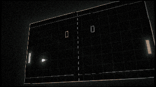

Before the demoscene there was the arcade, and SEEDSCENE starts there: eleven
game-inspired visualizers that move to the music instead of a joystick. Not a
replay of the games — a show made of them. Every game scene plays on a
**board floating in space** — and a game that is a device of its own, the LCD
juggler, floats as that device — and the camera rides the music round it: a
new angle on every eight-bar phrase, a punch in on the kick, a lean on the
snare, the board's neon frame breathing with the bass, and a zoom blur on
every kick.

Nine of them are real games underneath, run as small simulations locked to
the beat. The chomper hunts the nearest dot and dodges, while the wisps chase
it — one straight at it, one cutting it off, one keeping its distance — and
flee after a power dot. The snake steers for its food, keeps itself room to
escape, grows, and when it finally boxes itself in it bursts and starts again.
The rock ship flies round the field, dodges what is about to hit it, leads
its target and fires on the eighths: a big rock breaks in two, a small one
bursts, and now and then a rock gets through. The starfighter slides over and
turns its nose onto a drone — two sights ahead of it show where it points —
and fires from its wings along the nose once the sights are on; two hits and
the drone bursts. The drones come in from the far distance — over the planet,
from just above the horizon — and fire back on the backbeat; the ship slides
out of the way of the shots it sees, and one that lands shakes it and flashes
the screen once. The pyramid hopper turns the cube tops a hop a beat while the
red balls drop onto the second row and bounce down on the off-beats, and the
egg hatches into a snake that chases; a ball on its cube and it stops and
swears in a balloon, and with the snake close behind it rides a disc to the
top and the snake, following, falls.

Four of those nine play on the music's own grid, so their big moments land on it.
In **paddles** every return falls on a beat, and on an accent - the crash
that opens a phrase, the drop - the paddle the ball is heading for misses
and is blown apart on that very note; the other side scores. In **invaders**
the cannon times its shots so each alien bursts on a beat, and a saucer that
crosses the top is brought down on the accent. In **bricks** every flight of
the ball is timed to land on an eighth or a sixteenth, so the wall breaks on
the rhythm, and the paddle aims each return somewhere new. In
**lightcycles** four riders fly across the grid trailing walls of light,
turning on the beat and dodging between beats; a rider goes down only where
the music turns - two beats ahead, the game sends one of them into another's
wall, timing its speed so it blows up on the downbeat that opens a phrase, or
on an accent. Same seed, same game, move
for move.

They are homages, drawn from nothing but maths — no sprite, no maze, no
character and no tune is copied from any game. The creatures in the
formation, the mazes, the rocks and the challenger robot are all made up by
the seed.

## Scenes, straight out of the scene

<!-- Each entry follows docs/SCENE-ENTRIES.md: era by era, the memory, the wink, the music, at most forty words. npm test checks it. -->

Era by era, oldest first. Each one is a memory of its time, made from scratch.

### 1972–1981 · the first video games

| | | |
|---|---|---|
| 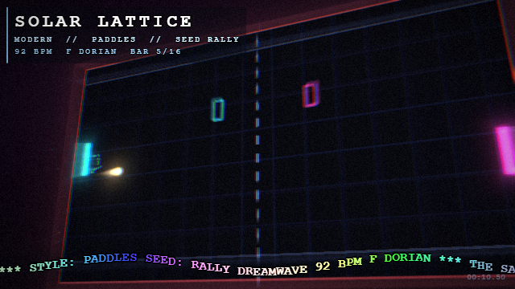 | 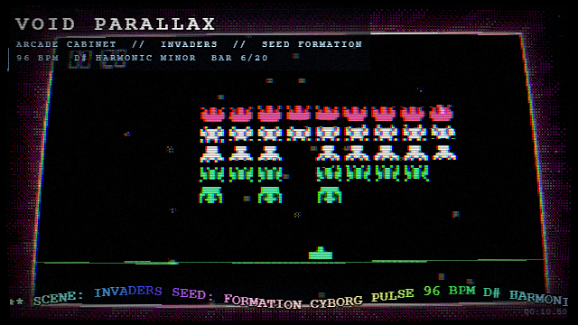 | 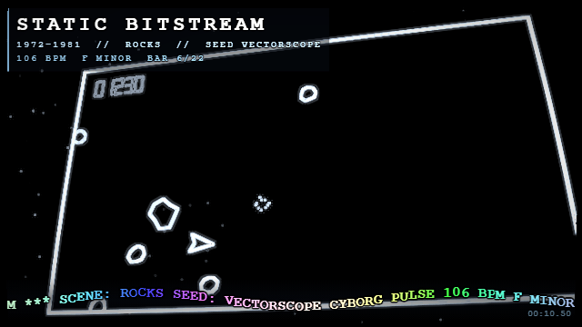 |
| **paddles** — the first video game, in neon: a return on every beat, and on an accent a paddle misses and is blown apart. `--scene paddles --era 1972 --seed rally` | **invaders** — the marching formation of the late-70s arcades, its aliens made up by the seed: a step a beat, each alien bursting on a beat as the cannon's shot lands. `--scene invaders --era 1972 --seed formation` | **rocks** — the rock shooter of the vector arcades, in glowing phosphor lines: a ship that flies, dodges and fires on the eighths, big rocks breaking in two. `--scene rocks --era 1972 --seed vectorscope` |
| 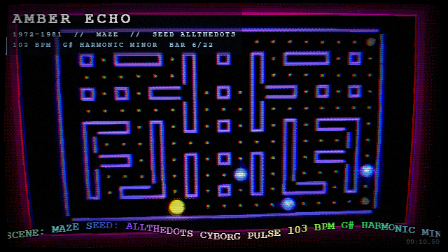 | 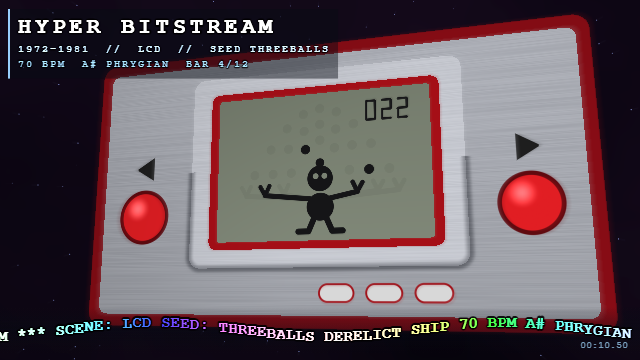 |   |
| **maze** — the dot-chomping maze chase, in neon: a chomper hunting dots round a mirrored maze, three wisps on its tail, a new maze each time it is cleared. `--scene maze --era 1972 --seed powerpill` | **lcd** — the juggling LCD handheld of 1980, the whole device: a maroon case, round red buttons, a juggler in black segments, the balls hopping cell by cell into a hand on the beat. `--scene lcd --era 1972 --seed juggler` |   |

### 1982–1989 · home computers, arcades and the video shop

| | | |
|---|---|---|
| 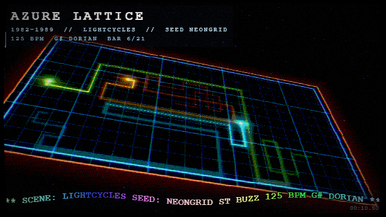 | 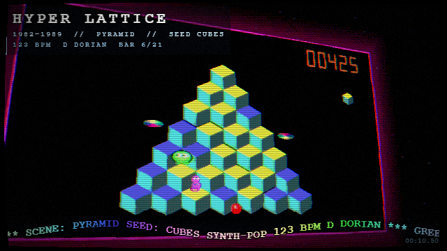 | 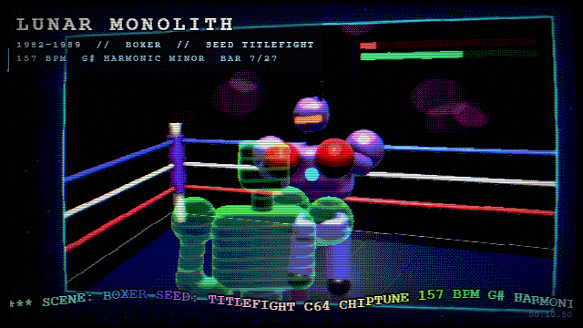 |
| **lightcycles** — the light-cycle duels of the early 80s, on a neon grid: four riders trailing walls of light, turning on the beat; on the downbeat that opens a phrase, one is sent into another's wall. `--scene lightcycles --era 1982 --seed neongrid` | **pyramid** — the cube-pyramid hopper of the 1982 arcades, played: a hop a beat to turn every top, red balls bouncing down between the beats, a snake hatching to chase it, lured off by a disc. `--scene pyramid --era 1982 --seed cubes` | **boxer** — the robot title fights of the 80s consoles: hooks, jabs and uppercuts on the beat, your see-through boxer slipping and punishing; on the crash a star punch, a knockdown and the count. `--scene boxer --era 1982 --seed titlefight` |
| 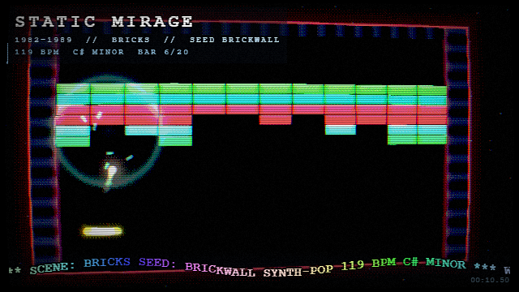 | 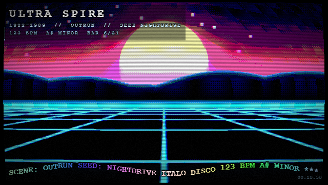 | 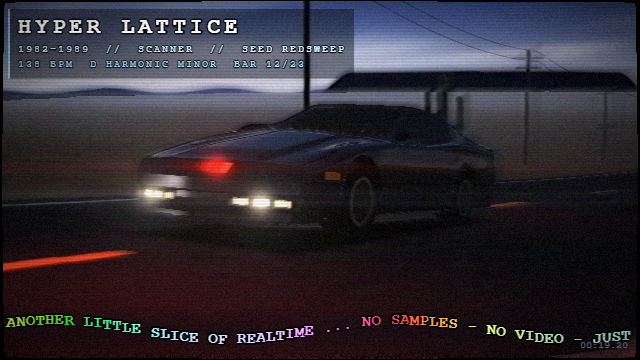 |
| **bricks** — the brick-breaking arcade of the mid-80s, in neon: a wall broken on the rhythm, every flight of the ball landing on an eighth or a sixteenth. `--scene bricks --era 1982 --seed brickwall` | **outrun** — the synthwave sunset the 80s left behind: a striped sun sinking behind mountains over a neon grid. `--scene outrun --era 1982 --seed nightdrive` | **scanner** — the talking car of 80s television, as an idea: a long black car coming down a night road at you, the red light in its nose sweeping once a beat. `--scene scanner --era 1982 --seed redsweep` |
| 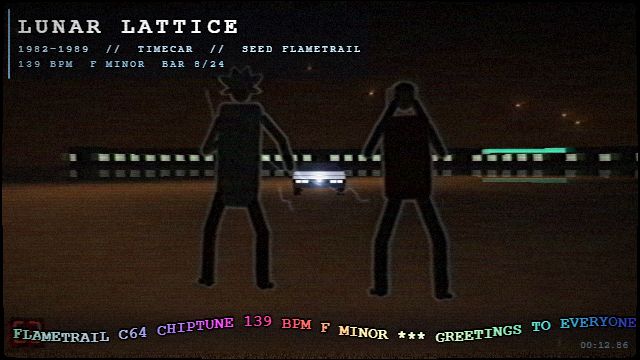 | 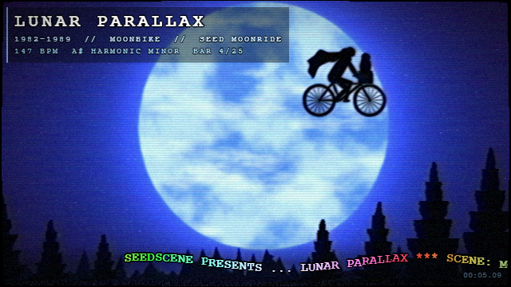 | 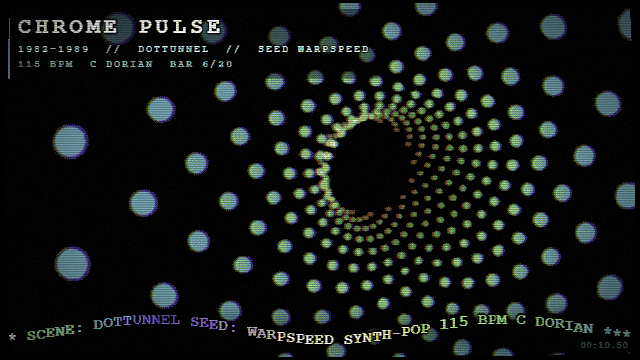 |
| **timecar** — the time-travel car of the 80s, as an idea: a stainless wedge charging two onlookers across a wet night parking lot, its readout reaching 88 on the music's big moment, then gone in a burst, leaving trails of fire. `--scene timecar --era 1982 --seed gigawatts` | **moonbike** — the boy and his friend from the stars, as an idea: a bicycle crossing a huge pale moon in silhouette, a bundle in the basket, its wheels turning a turn a beat. `--scene moonbike --era 1982 --seed moonride` | **dottunnel** — the dot tunnels of the 8-bit demos: rings of dots rushing down a snaking tunnel. `--scene dottunnel --era 1982 --seed warpspeed` |
| 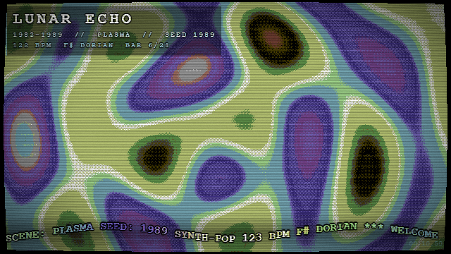 | 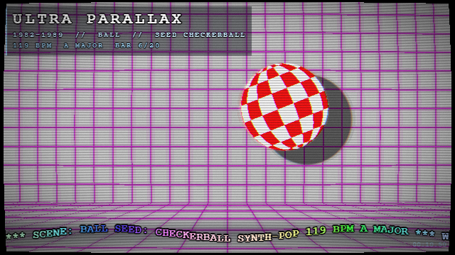 |   |
| **plasma** — the plasma every demo of the 80s and 90s had: sine waves melting through a cycling palette. *Also 1990–1993 · 1994–1996.* `--scene plasma --era 1982 --seed 1989` | **ball** — the bouncing checkered ball of the Amiga's first demos: red and white, spinning on its tilted axis, bouncing across a grid room and landing on every beat. `--scene ball --era 1982 --seed boing` |   |

### 1990–1993 · the demoscene's golden years

| | | |
|---|---|---|
| 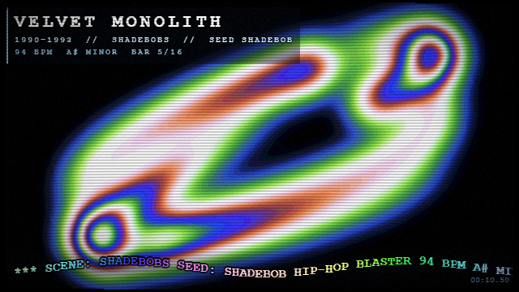 | 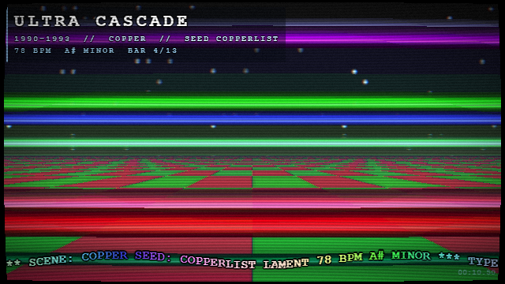 | 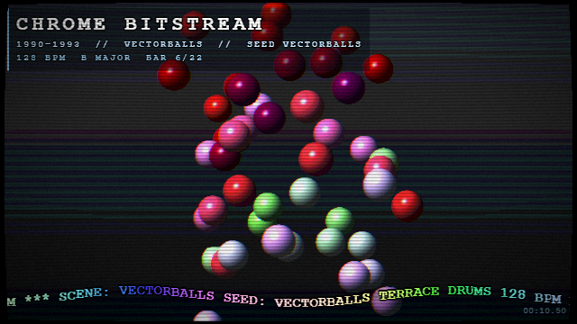 |
| **shadebobs** — the shadebobs of the Amiga demos: glowing trails that wrap round the palette. `--scene shadebobs --era 1990 --seed shadebob` | **copper** — the copper bars of the Amiga: glowing bars over an endless checkerboard. `--scene copper --era 1990 --seed copperlist` | **vectorballs** — the vector balls of the Amiga demos: shaded spheres turning in 3D, morphing into a new shape every two bars. `--scene vectorballs --era 1990 --seed vectorballs` |
| 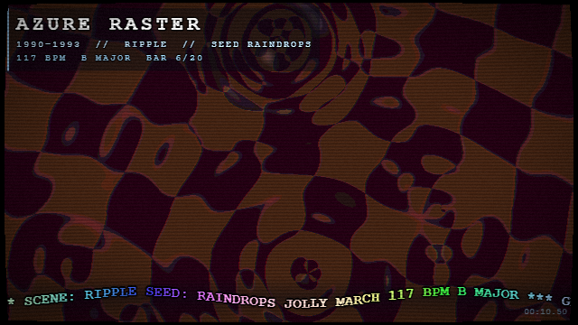 | 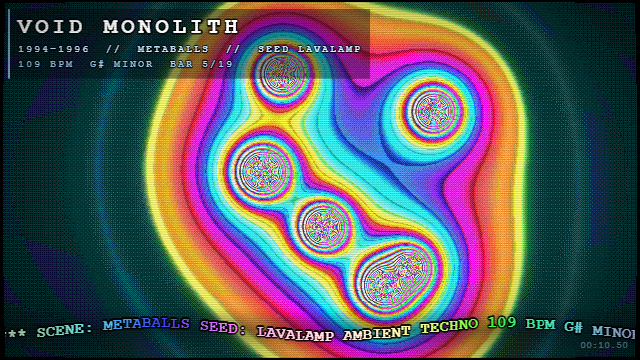 | 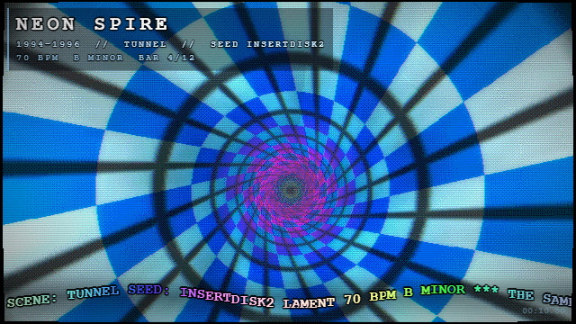 |
| **ripple** — the water of the early-90s demos: drops landing on the beat across a pool floor. `--scene ripple --era 1990 --seed raindrops` | **metaballs** — the metaballs of the demos: liquid blobs that merge and split. *Also 1994–1996.* `--scene metaballs --era 1994 --seed lavalamp` | **tunnel** — the texture-mapped tunnel of the demos, twisting, punched by the kick. *Also 1994–1996.* `--scene tunnel --era 1994 --seed insertdisk2` |
| 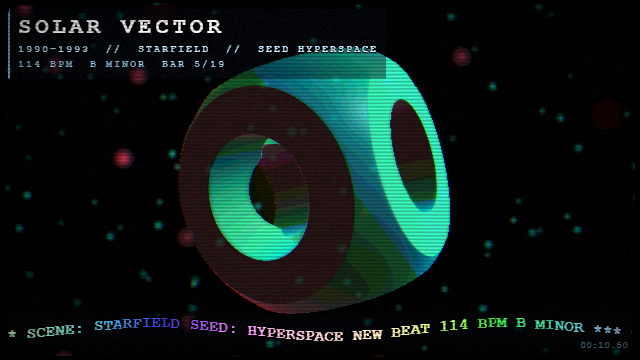 | 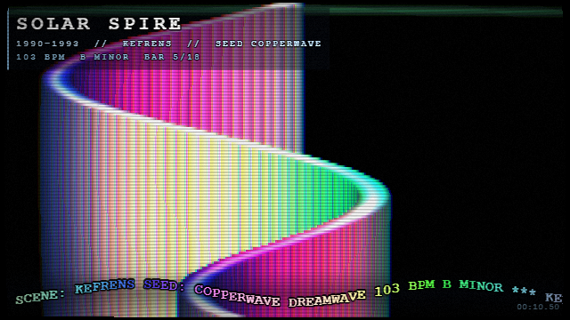 | 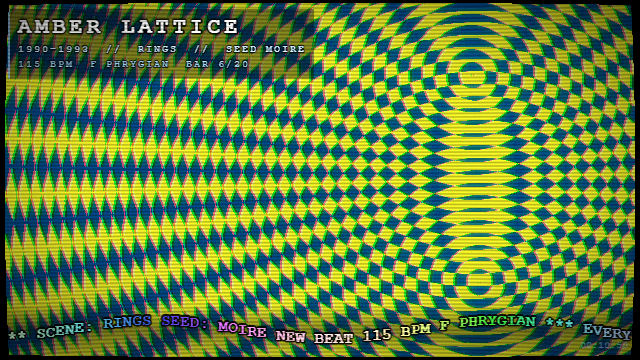 |
| **starfield** — warp speed round a glenz vector, the see-through drilled solid of the Amiga demos. `--scene starfield --era 1990 --seed hyperspace` | **kefrens** — the bar ribbon of the Amiga demos: a shaded bar on every raster line, never cleared, piling into a ribbon that weaves wider on the bass. `--scene kefrens --era 1990 --seed copperwave` | **rings** — the interference rings of the demos: two sets of rings drifting through each other into a moiré that seems to move on its own, running outward on the kick. `--scene rings --era 1990 --seed moire` |
| 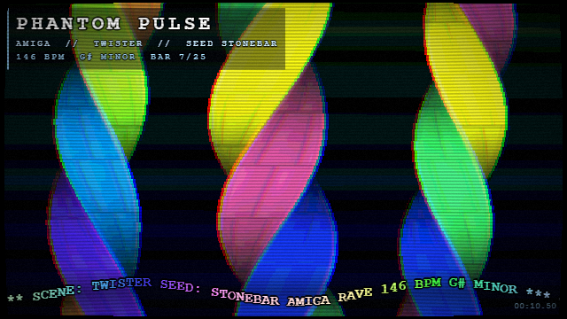 | 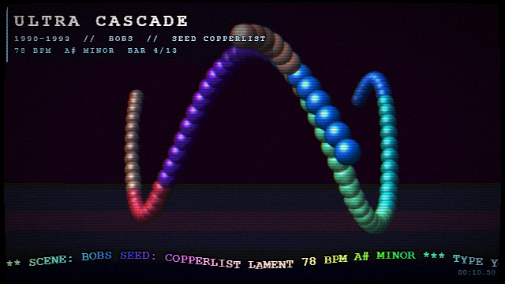 | 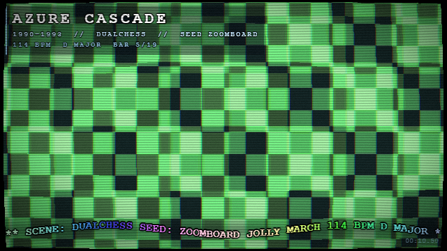 |
| **twister** — the twisted bar of the Amiga and Atari ST demos: a textured column twisting up the screen, winding up as the music builds, snapping a quarter turn on the kick. `--scene twister --era 1990 --seed stonebar` | **bobs** — the unlimited bobs of the Amiga and Atari ST: a chain of balls sliding behind its head because the screen is never cleared, surging on the kick, a twin chain weaving the other way. `--scene bobs --era 1990 --seed copperlist` | **dualchess** — the dual chessboard of the Amiga intros: two zooming boards sliding past and then turning against each other, every overlap its own shade, punching in on the kick. `--scene dualchess --era 1990 --seed zoomboard` |
| 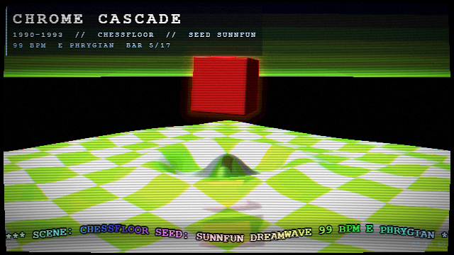 | 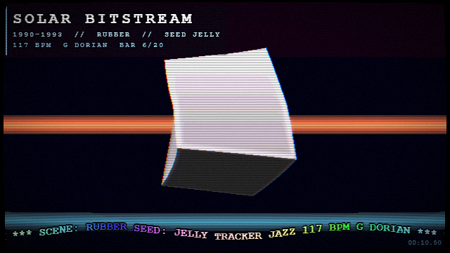 | 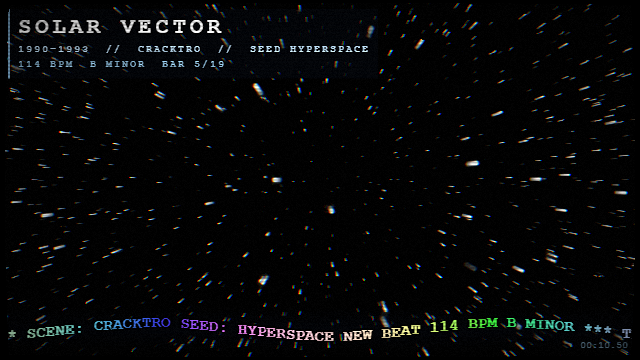 |
| **chessfloor** — the chessboard floor of the Amiga intros and its red cube: the board turning beneath you, rippling where the cube lands on the beat, the cube mirrored in it. `--scene chessfloor --era 1990 --seed sunnfun` | **rubber** — the rubber vector of the Amiga demos: a flat-shaded cube wobbling like jelly, the jolt of each kick running down it like a wave. `--scene rubber --era 1990 --seed jelly` | **cracktro** — the crack intro of the Amiga years: a chrome logo bouncing over copper lines, a greeting typed in a bitmap font, then a starfield steered by the music, warping into each new phrase. `--scene cracktro --era 1990 --seed hyperspace` |
| 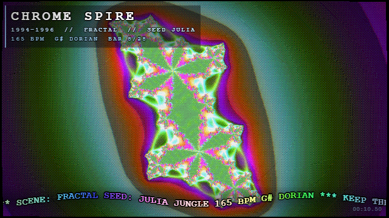 | 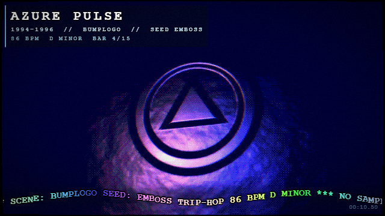 | 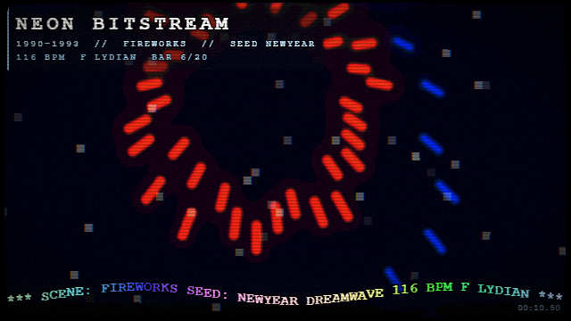 |
| **fractal** — the orbiting Julia set, the classic end-part. *Also 1994–1996.* `--scene fractal --era 1994 --seed julia` | **bumplogo** — the bump-mapped logo of the demos: an emblem raised out of stone, lit by circling coloured lights that flare on the snare, its relief deepening on the kick. *Also 1994–1996.* `--scene bumplogo --era 1994 --seed emboss` | **fireworks** — the fireworks of the demos: a burst on every backbeat, streaks falling to earth. `--scene fireworks --era 1990 --seed newyear` |
| 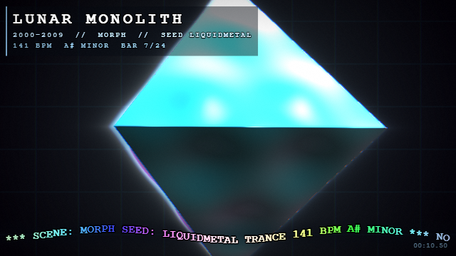 | 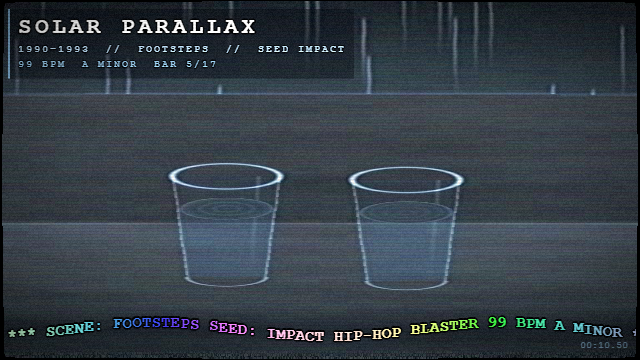 | 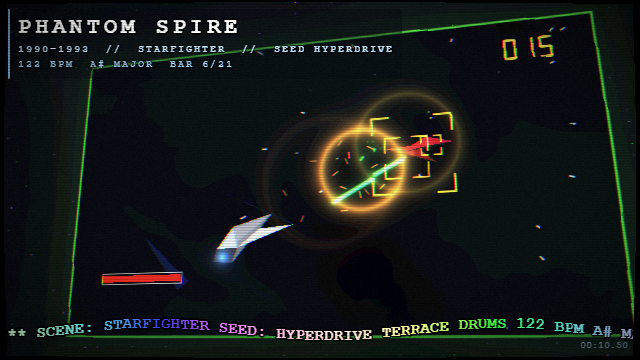 |
| **morph** — the morphing solid of the demos: a shape melting into the next on every bar. *Also 2000–2009.* `--scene morph --era 2000 --seed liquidmetal` | **footsteps** — the dinosaur films' most famous warning, as an idea: two cups of water on a dashboard at night, trembling into rings with every footstep - the left on the kick, the right on the snare. `--scene footsteps --era 1990 --seed impact` | **starfighter** — the space shooters of the 16-bit consoles, in flat-shaded polygons: a white fighter locking onto drones from the horizon, firing, dodging their shots, a warp at each new sector. `--scene starfighter --era 1990 --seed hyperdrive` |
| 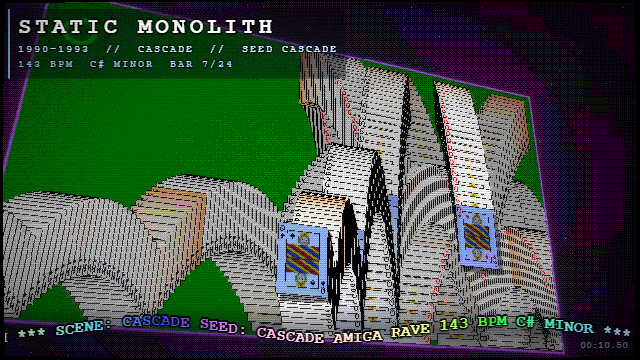 | 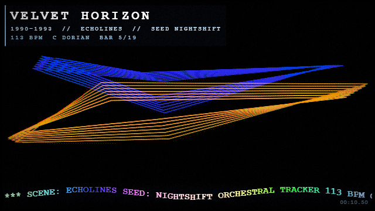 |   |
| **cascade** — the card cascade of the desktop's won card game: a card leaving the piles each bar, bouncing down the green table in a trail of copies, landing on the beat. `--scene cascade --era 1990 --seed cascade` | **echolines** — the bouncing-lines screensaver of the early 90s: two four-cornered figures bouncing off the screen's edges in fans of echoes that the kick stretches and the snare recolours. `--scene echolines --era 1990 --seed nightshift` |   |

*Also in this era: plasma.*

### 1994–1996 · the PC demos and the multimedia years

| | | |
|---|---|---|
| 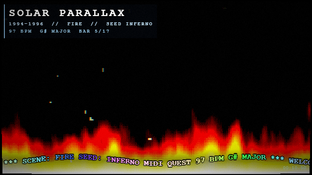 | 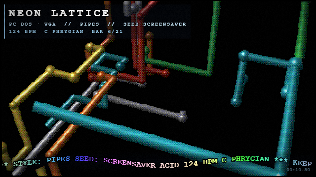 | 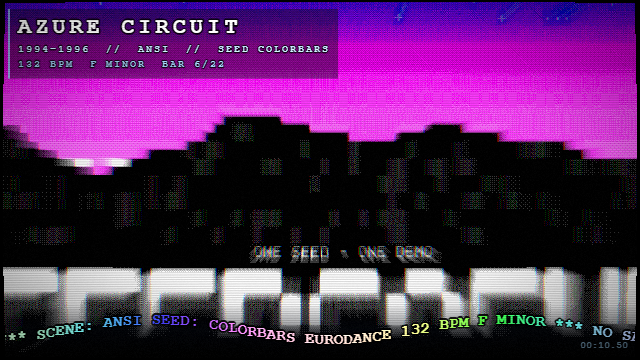 |
| **fire** — the 256-colour fire of the DOS demos: flames leaping on the kick, sparks on the snare, and at the peak an emblem of the seed's catching fire. `--scene fire --era 1994 --seed inferno` | **pipes** — the 3D pipes screensaver of the mid-90s office PC: shiny pipes growing cell by cell through a deep grid, turning on the eighths, until the screen is full and dissolves. `--scene pipes --era 1994 --seed screensaver` | **ansi** — the ANSI art of the bulletin boards, arriving over the modem: shaded pictures and block-letter logos in sixteen colours, a line a beat, the logo landing on the drop. `--scene ansi --era 1994 --seed colorbars` |
| 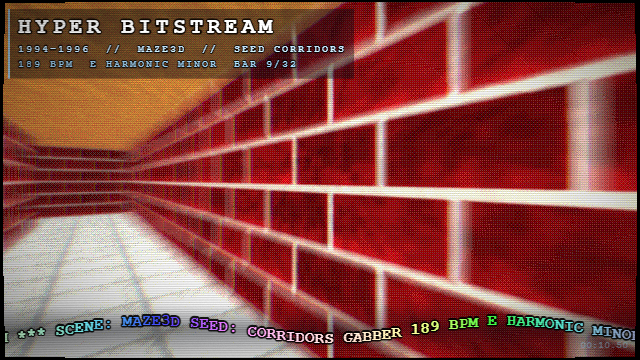 |   |   |
| **maze3d** — the 3D maze screensaver of the mid-90s, walked in first person: brick corridors, a step every two beats, and on the drop a spinning stone that turns the world upside down. `--scene maze3d --era 1994 --seed corridors` |   |   |

*Also in this era: fractal, tunnel, metaballs, plasma, bumplogo.*

### 1997–1999 · 3D consoles and pocket screens

| | | |
|---|---|---|
| 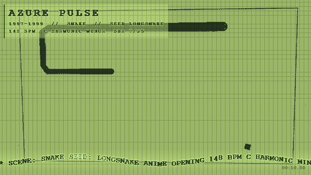 | 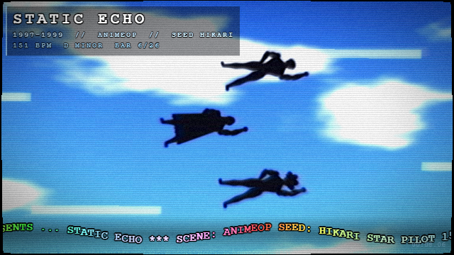 | 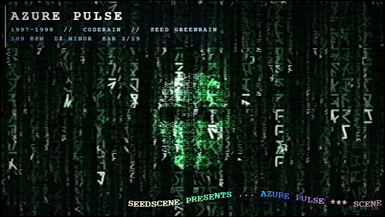 |
| **snake** — the snake game of the pocket phones, in neon: a snake that hunts its food, grows, and bursts when it boxes itself in. `--scene snake --era 1997 --seed longsnake` | **animeop** — the anime openings the 90s brought to Latin America, as an idea: a cut on every bar, a team posing against sunbursts, a power-up in lightning, and the seed slammed in as the show's title on the drop. `--scene animeop --era 1997 --seed hikari` | **coderain** — the falling green code of the millennium's cyberpunk screens, as an idea: glyphs typing their way down in sheets of depth, and out of the rain each phrase a face in dark glasses, the seed, SEEDSCENE. `--scene coderain --era 1997 --seed greenrain` |

### 2000–2009 · the 64k intro

| | | |
|---|---|---|
| 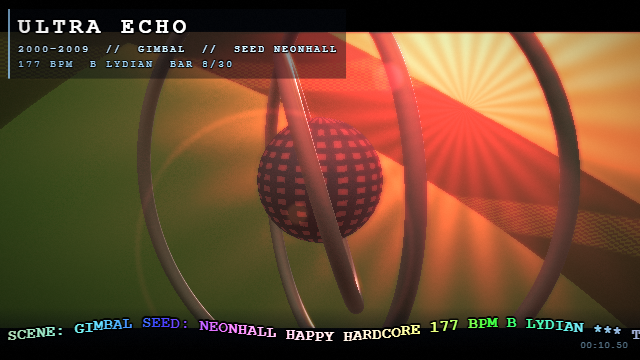 |  |   |
| **gimbal** — the 64k intros of the turn of the century: nested steel rings turning a quarter on the beat round a metal core, a light behind them flaring through the haze. `--scene gimbal --era 2000 --seed neonhall` | **djdecks** — the DJ decks of the 2000s' clubs and rhythm games, from above: two turntables and a mixer handing over each phrase with a scratch, in a club night of beams, smoke and lasers. `--scene djdecks --era 2000 --seed backspin` |   |

*Also in this era: morph.*

### 2010–now · shader art

| | | |
|---|---|---|
|  |  |  |
| **prism** — the tiny chromatic light pieces of 2010s shader art: a lattice of light pushed out by a wave, each colour a moment behind, a white star where they meet. `--scene prism --era 2010 --seed lightlattice` | **sculpture** — the raymarched still life of the 2010s: a ball travelling through an arch and a ring, melting into them as it passes, under soft shadows. `--scene sculpture --era 2010 --seed penumbra` | **fractalflight** — the mandelbox, found in 2010 and flown through by the decade's shader art: a slow flight over a palace of arches at every size, its glow lit by the kick. `--scene fractalflight --era 2010 --seed mandelbox` |

Every scene carries the two things no demo went without: a title plate and a
sine scroller that opens with **SEEDSCENE PRESENTS…** — and every scene is an
homage, written from scratch, to an effect the scene made famous.

## Thirty-five music styles, on the sound chips of their eras

Every seed composes its own track, like a tracker module that writes itself.
Let the era pick the style, or choose with `--music`, with `↑` `↓` while it
plays, or in the menu:

| style | | bpm |
|---|---|---|
| `chiptune` | Commodore 64 SID: pulse-width leads, square bass, 50 Hz arpeggio chords | 132–158 |
| `newbeat` | Belgian New Beat: slow, heavy EBM sequencer bass, big claps | 108–120 |
| `rave` | **Amiga rave, 1992**: chopped breakbeats, hoovers, sub bass, rave piano | 138–150 |
| `orchestral` | the orchestral tracker: strings, choir, timpani and brass in four channels | 96–120 |
| `dreamwave` | mellow cracktro synths and lush pads | 84–118 |
| `acid` | a squelching, sliding 303 over a 909, the filter knob always turning | 124–135 |
| `gabber` | Rotterdam, 1993: a distorted kick and nothing to hide behind | 175–190 |
| `ambient` | the chill-out room: deep pads, FM bells, a heartbeat kick | 92–110 |
| `eurodance` | hip-house organ bass, house piano, an anthem on top | 126–136 |
| `jungle` | amen breaks at 170 over a detuned reese bass | 164–174 |
| `heroic` | the game soundtrack: driving bass, brass, a lead that soars | 132–152 |
| `gameboy` | handheld chip: two pulses, a 4-bit wave, noise | 120–150 |
| `trance` | gated supersaws, rolling offbeat bass, snare rolls into big drops | 134–142 |
| `hardcore` | happy hardcore: 175 bpm, piano stabs, screaming leads | 168–180 |
| `synthwave` | the modern revival: gated snares, octave bass, neon arps | 92–118 |
| `arcade` | **arcade attract**: a pulse hook, a bass that marches down, zaps, blips and explosions in time and in key | 140–165 |
| `cyborg` | **cyborg pulse**: the mid-80s machine score — anvils in an odd 13-step metre, an ostinato bass, dark brass | 96–112 |
| `derelict` | **derelict ship**: deep-space dread — drones, a half-step that will not resolve, pings off the hull, a heartbeat | 64–76 |
| `synthpop` | **synth-pop**: the 80s chart single — gated drums, octave bass, the four chords everyone knows, a chorus you hum | 112–124 |
| `rocknroll` | **chip rock and roll**: a 50s shuffle on a sound chip — boogie bass, twelve bars, piano on the off-beat, a riff | 150–176 |
| `starpilot` | **star pilot**: 16-bit space opera — driving octave bass, a brass hook, orchestra hits, lasers in key, the minor sixth and seventh climbing home | 140–158 |
| `modjazz` | **tracker jazz**: the demo-party jazz tune — a walking slap bass, electric-piano comping on the off-beats, a flute that improvises, the ride swinging | 100–126 |
| `fmmetal` | **FM metal**: a DOS shooter at full tilt — palm-muted power chords, a double kick when it peaks, a guitar that solos | 150–178 |
| `midiquest` | **MIDI quest**: an adventure on a sound card — strings and choir, a harp running up and down, a flute, the timpani of a long road | 92–112 |
| `keygen` | **keygen**: the crack intros' tracker tunes, from the patterns of forty real ones — chords arpeggiated on the tracker's tick, a squelchy lead sliding into its notes with an echo channel a few rows behind, a bouncing bass, drum samples; 125 bpm most often, the tracker's default | 120–140 |
| `triphop` | **trip-hop**: the 90s Bristol sound — a slow break pitched down and shuffled like an MPC, the kick leading into the beats, a big roomy snare and a side-stick, the ride on the upbeats; a deep sliding bass, dark film-score strings, a Rhodes, a theremin, a record scratched at the end of a phrase, the crackle under it all | 68–90 |
| `animeop` | **anime opening**: the 90s anime opening, in the anison's form — an intro, a verse, a prechorus climbing into a chorus you could sing - mostly steps, an arch to each phrase, the same tune every time it returns, the brass joining it in the last one - the Royal Road progression under it, often a minor third up from the verse, and the last chorus a step higher still; J-rock drums, driving bass, palm-muted then open guitars, brass stabs | 140–170 |
| `beast` | **beast lands**: the long walk under a purple sky — tribal toms in a slow 6/8, a pan flute, a bowed drone on the tonic, a mysterious minor | 96–114 |
| `agony` | **lament**: the quiet part of the demo — a slow piano broken in eighths over strings, a lonely lead, the rain on the window, a slow pulse | 66–80 |
| `ballad` | **musicdisk ballad**: the tune you play twice — a slow four-channel ballad, a lead singing with vibrato under A5 as a tracker's did, an arpeggio, a soft beat | 80–96 |
| `march` | **jolly march**: a column of little soldiers — a march at 120, rudimental snare drags and rolls, an oom-pah tuba, a whistled tune, and a dance beat under it when it gets going | 112–124 |
| `bomb` | **hip-hop blaster**: the shooter with a beat — a slow boom-bap break, scratches, orchestra stabs, a lead chopped like a rap (no voice) | 88–100 |
| `italo` | **italo disco**: the 80s Italian dance floor — an octave bass in sixteenths, an arpeggiator, a drum machine with hand claps and an open hat on the off-beat, a vocoder singing the tune, a minor key | 115–125 |
| `stchip` | **ST buzz**: the Atari ST demos — the YM2149's envelope run at audio rate as a buzzing bass, chords stepped as 50 Hz arpeggios, a square lead, digi-drums and the noise channel's hats; 125 bpm most often, where a 50 Hz player falls | 118–140 |
| `skatepunk` | **skate punk**: the skateboarding games' punk — ska verses, the guitar chopping on the off-beats over a backbeat and the bass walking; punk choruses, the snare on every "and", the kick on the beat and the sixteenth after (or doubled before the snare), the hats open, power chords hammered on the eighths; a synth chorus shouted like a gang, a few notes, the same each time | 180–200 |

Each one is arranged like a real piece — intro, build, main part, a breakdown
with a riser, a crash into the drop, an outro. Many are built around a
**hook** - trance, synthwave, arcade attract, cyborg pulse, synth-pop, star
pilot, tracker jazz, FM metal, MIDI quest, chip rock and roll among them: a
two-bar call and answer the seed writes, landing on the
chord on the strong beats and coming home every fourth bar, so it sticks. Every sound is synthesized from
scratch in plain JavaScript: 909, gabber and break kicks, claps, a 303, a reese,
hoovers, supersaws, a rave piano, a house organ, strings, choir, timpani,
brass, FM bells, SID pulses, a 4-bit wave, struck anvils, laser zaps, coin
blips, explosions and deep-space drones. No recorded samples anywhere (on the
Amiga, Paula plays samples SEEDSCENE cuts from its own instruments) — and no melody
borrowed from anyone: the moods of the arcades, the sci-fi scores and the
charts are homages to sounds, not copies of songs. The chord loops are the
public-domain kind every pop song shares; every tune on top is the seed's.

**The sound chips.** A score says which notes to play; the sound board says what
plays them (see **Sound boards**). Five boards are chips, each playing the same
score on the sound of its machine:

| board | eras | how it sounds |
|---|---|---|
| `sid` **SID** | 1982–1989, by the seed (half the tracks) | the C64's 6581 on the PAL clock, from its datasheet: a pulse whose width sweeps, a sawtooth, a triangle and the 23-bit noise register, at the pitches its 16-bit frequencies allow; the envelope's 256 steps at the datasheet's rates, the decay and release falling in a curve; the 6581's two-pole filter, low-, band- or high-pass with its resonance, sweeping and distorting a little; ring modulation for bells, hard sync for a sweeping lead. The music player's 50 Hz frame: chords as arpeggios on one voice, vibrato that waits, a filtered pulse bass, and drums from waveform tables - a frame of noise then a square falling in pitch for the kick, a punch of pulse then noise for the snare. Mono and dry. |
| `ym` **YM2149** | 1982–1989, by the seed | the Atari ST's chip on its 2 MHz clock: square waves at the pitch its 12-bit periods allow (high notes a little off), a 4-bit volume 3 dB a step written once a frame (the music player's 50 Hz), the hardware envelope run at audio rate as a buzzing sawtooth bass, chords stepped as 50 Hz arpeggios on one channel, the noise channel's hats, and digi-drums - drums played as samples through the volume register. Mono and dry. |
| `paula` **Paula** | 1990–1993 | every instrument sampled once, as a tracker musician would, cut to 8 bits at about 16.7 kHz (the drums at 28 kHz) and played back by stepping through the sample faster or slower with no smoothing — the grain and the aliasing of a MOD. Sustained sounds loop. Drums and lead hard left, bass and chords hard right, through the A500's output filter, almost dry. |
| `opl3` **Sound Blaster 16 (OPL3)** or `awe32` **AWE32** | 1994–1996, by the seed | OPL3: two-operator FM with the chip's seven waveforms and operator feedback, FM drums, and dry, like a DOS game. AWE32: wavetable instruments — a grand piano, string and brass sections, a choir, plucked bass and guitar, an acoustic kit — with the card's chorus and reverb. |
| `awe32` **AWE32-style wavetable** | 1997–1999 | the sampled sound of the CD-era consoles |

Hear all thirty-five back to back, each on the boards of its eras:

```bash
npm run sampler        # → out/music-sampler.mp3
```

And check them as music, from their scores - the harmony, the melody, the
grid, the mix - all of them or one at a time ([the review](docs/MUSIC-REVIEW.md),
[the latest audit](docs/MUSIC-AUDIT.md)):

```bash
npm run audit:music -- keygen
```

Past the audit, the review tools listen to a style's rendered audio the way a
critical ear would: each part alone and its level in the mix, the
accompaniment over the lead, an instrument's spectrum, the fills and rolls,
one note alone, and the dead air where everything stops at once. A reviewer
subagent ([.claude/agents/music-reviewer.md](.claude/agents/music-reviewer.md))
runs them on every new or changed style, against a checklist of what the
owner has heard by ear, before anyone listens:

```bash
npm run review:music -- gaps bomb
```

## The About part

Press **`A`** in live mode and SEEDSCENE plays its own demo about itself — the
part every production saved for the credits: a bouncing rainbow logo, a
greetings scroller racing along the top, pages slamming in on the beat, a
giant sine scroller with its reflection, raster bars over a spinning
checkerboard tunnel, and its own happy-hardcore soundtrack. `A` again drops
you back into your demo exactly where you left it.

## The promise: same seed, same demo

Not "similar". **Identical, byte for byte.** Every random choice is drawn from
a seeded generator; the synth counts in samples, not in clock time; the
renderer steps frame by frame and draws in software, so your graphics card
cannot change a pixel. THE JOURNEY and AUTOPLAY keep the same promise.

```bash
npm test     # the score, the audio, the choices, the programmes, the displays and boards - and the same seed rendered twice, compared
```

That is what makes a seed worth sharing.

## For the tinkerers

Everything is web technology: WebGL2 fragment shaders for the scenes, a post
pass that draws each display's screen, an AudioWorklet for live sound, headless
Chrome and ffmpeg for the mp4. The visuals never listen to the audio — the
composer hands them each instrument's envelope directly — so the zoom lands on
exactly the frame the kick does, live or rendered.

```
seed ──> scene · era · music ──> composeScore ──┬──> Synth     ──> samples  ──> speakers / wav
                                                └──> Features  ──> uniforms ──> scene, full resolution
                                                                               ──> display's screen ──> pixels
```

<details>
<summary><b>All command-line options</b></summary>

```
seedscene live    [options]     run it in a browser, in real time
seedscene render  [options]     render a demo to an mp4 file
seedscene journey [options]     render THE JOURNEY to an mp4 file
seedscene autoplay [options]    render AUTOPLAY to an mp4 file, as long as you like
seedscene scenes                list the eras, scenes and music styles
seedscene info    [options]     show what a seed composes
```

| option | meaning | default |
|---|---|---|
| `--seed <word>` | anything at all; the same word always gives the same demo | random |
| `--scene <name>` | one of the fifty-one scenes (`--style`, its old name, works too) | chosen by the seed - one of the era's, if the era is given |
| `--era <name>` | `auto` `1972` `1982` `1990` `1994` `1997` `2000` `2010` — or any year inside one, or its old name (`arcade` `c64` `amiga` `dos` `console` `handheld` `y2k` `modern`) | an era the scene belongs to |
| `--display <name>` | `auto` `bw` `arcade` `vector` `colorvector` `mono` `c64` `vhs` `ega` `amiga` `vga` `snes` `composite` `gameboy` `nokia` `svga` `modern` | the screen: on `auto` each scene its own, or its era's |
| `--board <name>` | `auto` `hifi` `paula` `opl3` `awe32` `ym` `sid` | the sound board: on `auto` each scene its own, or its era's |
| `--music <name>` | `auto` or one of the thirty-five styles | music of the era |
| `--res <WxH\|preset>` | `854x480`, or `240p` `360p` `480p` `576p` `720p` `1080p` (or `--width` and `--height`) | `480p` |
| `--duration <seconds>` | length | 30 render, 180 live, 126 journey (21 s an era, three scenes each), 600 autoplay |
| `--born <year>` | autoplay only: open in the era you were twelve in, and stay near it | — |
| `--greets "A, B"` | names to greet in the scroller and the cracktro, up to eight | — |
| `--fps <n>` | frames per second | 30 |
| `--out <file.mp4>` | output path | `out/<seed>-<scene>.mp4`; `out/<seed>-journey.mp4`, `out/<seed>-autoplay.mp4`, `out/<seed>-born<year>.mp4` |
| `--crf <n>` | h.264 quality, lower is better | 18 |
| `--format <png\|jpeg>` | frame transfer format; jpeg is faster | png |
| `--gpu` | draw on the GPU: faster, but no longer identical across machines | off |
| `--no-overlay` | drop the title plate and the scroller | — |
| `--no-intro` | live mode: skip the LOAD sequence, straight to `READY.` | — |
| `--mute` | live mode: start with the sound off, to watch only (`V` turns it on) | — |
| `--port <n>` / `--no-open` | live server port; don't launch a browser | 8787 |

Run `npm link` once to type `seedscene` instead of `node bin/seedscene.js`.

</details>

<details>
<summary><b>Put it on the web</b></summary>

The live demo is a static site: nothing runs on the server. Build it and copy
the folder to any host that serves files — GitHub Pages, Netlify, an S3
bucket, nginx — at its root or in a subfolder:

```bash
npm run build:web
```

That writes `dist/` (about 550 KB, no build step, no dependencies). Its
`index.html` opens the live page: a visitor arriving with no seed of their own
gets the seed `seedscene`, straight into AUTOPLAY. A link with a seed opens
that seed's demo instead, and every setting of the live page works in the
address the same way (`?seed=aurora&scene=cracktro`, `&autoplay=1` to start in
AUTOPLAY, `&journey=1` in THE JOURNEY, `&born=1985` born in a year,
`#greets=ANA,LUIS` with greetings, `&sound=0` to start silent, `&display=` and
`&board=` to force a screen or a sound board, `&saver=<seconds>` for the
screensaver - 60 by default, 0 off); the address keeps what the viewer
changes, so a reload or a shared link brings back the same demo.

On GitHub, publishing a release does all of it: a workflow checks the
same-seed promise, builds the site and deploys it to GitHub Pages — see
[docs/DEPLOY.md](docs/DEPLOY.md). The sound needs HTTPS: browsers allow the audio
worklet only on secure pages (or on `localhost`).

</details>

<details>
<summary><b>What's in the box</b></summary>

```
bin/seedscene.js      the command line
src/brand.js          the logo, the name and the About part texts
src/core/eras.js      the eras: spans of years, their scenes and music
src/core/displays.js  the displays: palette, dither, screen and signal, each scene's own
src/core/boards.js    the sound boards, each scene's own
src/core/catalogue.js the scenes and music in era order, dealt by the seed
src/core/choose.js    what 'auto' means: scene, then era, then music
src/core/journey.js   THE JOURNEY and AUTOPLAY: tracks mixed beat on beat
src/core/sims.js      the games under the game scenes, and the scenes that move with the music
src/core/rng.js       seeded random streams
src/core/music.js     composer, thirty-five styles, synthesizer, feature track
src/core/chips.js     the sound chips: Paula, OPL3, AWE32, YM2149, SID
src/core/visual.js    renderer, palette, title plate, scroller, era cards
src/core/gl.js        WebGL2 helpers
src/styles/index.js   the fifty-one scenes, the 3D stage, the About part, the display's screen
src/app.js            ties the music and the picture together
web/index.html        the live page
web/boot.js           the C64 boot screen
web/menu.js           the SETUP menu
web/live.js           real-time loop, locked to the synth clock
web/worklet.js        AudioWorklet host for the synth
web/render.html       the page headless Chrome draws into
web/render.js         its script
tools/render.js       audio + frames + ffmpeg → mp4
tools/wav.js          the soundtrack as a WAV for ffmpeg
tools/gallery.js      regenerates the images on this page (npm run gallery)
tools/sampler.js      every music style in one mp3 (npm run sampler)
tools/music-audit.js  every music style checked as music (npm run audit:music)
tools/music-review.js a style's rendered audio measured as a listener hears it (npm run review:music)
tools/timbre-refs.js  real instruments' spectra the audit compares a sound with
tools/server.js       local static server
tools/build-web.js    the live demo as a static site (npm run build:web)
.github/workflows/    publishing the site to GitHub Pages on each release
test/determinism.mjs  the same-seed promise, checked
.claude/agents/       the music reviewer, a subagent for Claude Code
SEEDSCENE.NFO         the release notes, the way they used to be written
```

Node 18+. `npm install` brings its own Chromium and its own ffmpeg; nothing
else to install.

</details>

## Built with agent-plugins

SEEDSCENE was written end to end by Claude, in Claude Code, with the ten
self-monitoring plugins from
**[3dgiordano/agent-plugins](https://github.com/3dgiordano/agent-plugins)**
running the whole time — with the
[v0.20.0](https://github.com/3dgiordano/agent-plugins/releases/tag/v0.20.0)
release installed for the finish of v0.2. They are what made the agent *watch* its own demos instead of
trusting its code: that is how broken effects were caught in rendered frames,
from metaballs that never merged to a dot tunnel that vanished in four shades
of green, and how a live-mode glitch was traced to two synths fighting over
one clock.

The exact plugin set for each version, with commits and what each plugin
caught, is on record in [docs/AGENT-PLUGINS.md](docs/AGENT-PLUGINS.md).
How each version was built, with token counts and cost, is in the build
reports: [v0.2](docs/BUILD-REPORT-v0.2.md) · [v0.1](docs/BUILD-REPORT-v0.1.md).

```bash
claude plugin marketplace add 3dgiordano/agent-plugins
```

## Greetings

To everyone who ever dropped a coin and pressed start. To everyone who ever typed `LOAD` and waited. To everyone who ever inserted
disk 2. To the trackers and the people who made them sing. To every coder
still up at 3 a.m. chasing one more frame — on a C64, an Amiga, a 486, a
handheld, or a GPU. To the kids about to type their name and see their first
demo.

**Keep the scene alive.**

---

<sub>v0.2 · [MIT license](LICENSE) · [changelog](CHANGELOG.md) · [release .NFO](SEEDSCENE.NFO) · build reports [v0.2](docs/BUILD-REPORT-v0.2.md) · [v0.1](docs/BUILD-REPORT-v0.1.md) · [agent plugins](docs/AGENT-PLUGINS.md)</sub>
